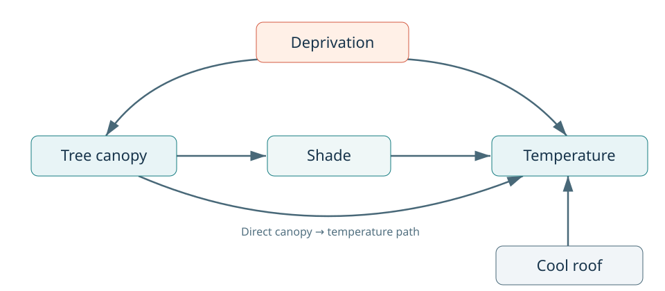
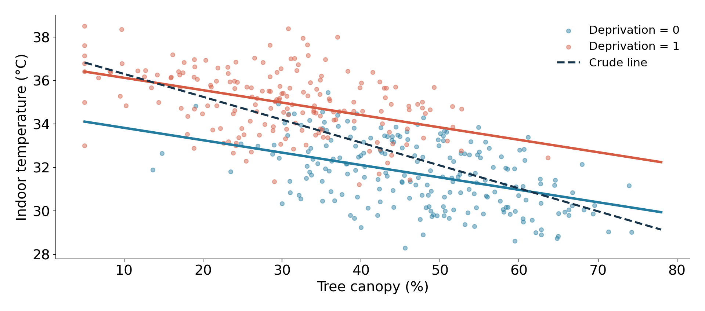
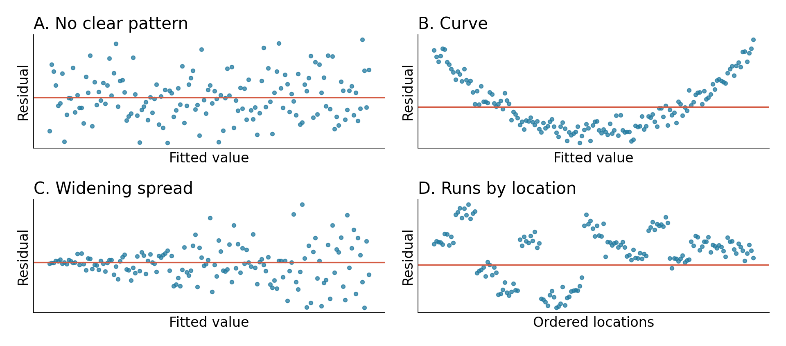
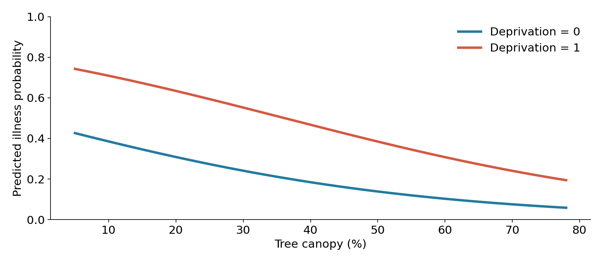

## Two classes, one modeling workflow

| Class 1                             | Class 2                     |
|-------------------------------------|-----------------------------|
| DAG-based adjustment                | Logistic interpretation     |
| Linear models and diagnostics       | Poisson counts and exposure |
| Lab 1, then a logistic introduction | Lab 2 in two parts          |

**Our goal:** explain the comparison a model estimates.

::: notes
Two 75-minute periods. Class 1 includes 40 minutes of linear-model concepts, a 25-minute lab and a 10-minute logistic bridge. Class 2 includes two 15-minute lab blocks. The students already know confounders, mediators and moderators. Connect to those ideas rather than reteaching DAGs. Use arrows/Space to advance, Esc for overview and S for speaker view. The original scrolling lecture remains available as 01_lecture_notes.html.
:::

## One simulated urban heat study

400 households, with one respondent per household.

| Outcome                         | What is measured?                  |
|---------------------------------|------------------------------------|
| Indoor temperature              | Degrees Celsius                    |
| Respondent heat illness         | Yes or no during a fixed window    |
| Household heat illness episodes | A count over measured person-weeks |

The same canopy contrast appears in all three models.

::: notes
All observations are synthetic, and each household is treated as independent. No real people or places are represented. The outcomes were generated separately conditional on specified predictors. They are not an observed biological chain from temperature to illness to episodes. The count follow-up window varies, while the binary outcome uses one common fixed window. This distinction matters for denominators. The labs contain the data dictionary.
:::

## Class 1: the causal question {#class-1}

Does greater residential tree canopy reduce indoor heat?

| Decision | Our target                       |
|----------|----------------------------------|
| Unit     | One household                    |
| Exposure | Tree canopy around the home      |
| Outcome  | Indoor temperature, °C           |
| Contrast | 10 percentage points more canopy |
| Effect   | Total effect, including shade    |

::: notes
Class 1, minutes 0–5. Ask students to identify the unit, exposure, outcome, contrast and total-effect target before revealing the entries. A 10 percentage point contrast means 20% to 30%, for example. We want the pathways through shade to remain part of the effect. The fitted analysis will use associational wording unless the causal assumptions are justified.
:::

## Which path needs adjustment? {.figure-slide}

{.dag-figure}

**Discuss:** Which variable blocks a backdoor path? What happens if we add shade?

::: notes
Class 1, minutes 5–12 begins here. Give students 45 seconds to trace the path canopy ← deprivation → temperature. Higher deprivation is associated with lower canopy and higher indoor temperature in this simulation. Deprivation is a common cause. Shade is a mediator. Roof is an independent outcome predictor in this particular simulation. The direct canopy-to-temperature arrow represents pathways other than the measured shade index. DAGitty identifies deprivation as the minimal adjustment set under these arrows, but does not verify the arrows or choose functional forms.
:::

## From the DAG to the formula

| Variable    | Decision for the canopy total effect      |
|-------------|-------------------------------------------|
| Deprivation | Include to block the backdoor path        |
| Shade       | Exclude to keep the mediated pathway open |
| Cool roof   | Optional outcome predictor for precision  |

``` r
indoor_temp_c ~ canopy10 + deprivation + cool_roof
```

::: notes
The question determines the adjustment set. More predictors do not necessarily make a causal model better. A collider can open a noncausal path, and a mediator changes the target. A separate collider example is canopy → study participation ← heat illness: conditioning on participation can induce an association. The cool-roof decision is specific to the supplied DAG; in a real study it could have a different causal role. Do not choose adjustment variables with stepwise procedures, p-values or the largest R-squared.
:::

## A linear model describes a mean

The fitted line describes **average temperature** at a predictor value.

- A slope describes the change in that mean.
- A residual is observed temperature minus fitted temperature.
- Least squares chooses coefficients to minimize squared residuals.

A particular household can lie above or below its predicted mean.

::: notes
Class 1, minutes 12–22 begins here. Keep this intuitive: regression does not claim each household follows the line exactly. Squaring prevents positive and negative residuals from cancelling and gives larger residuals greater weight. A mean prediction and a prediction for one new household answer different questions. No derivation of ordinary least squares is needed.
:::

## Continuous predictor: first settle the unit

``` r
canopy10 = canopy_pct / 10
```

| Change            | Units of `canopy10` |
|-------------------|--------------------:|
| 20% to 30% canopy |                  +1 |
| 20% to 40% canopy |                  +2 |

**10 percentage points** differs from a **10% relative increase**.

::: notes
Ask students to calculate a 10% relative increase from 20% canopy: it is 22%, a two-percentage-point change. Rescaling canopy makes a coefficient easier to discuss without changing the model's fitted values. A slope of -0.57 per canopy10 is a slope of about -0.057 per one percentage point. Students should always state the contrast and units rather than saying simply “a one-unit increase.”
:::

## Binary predictor: a group comparison

`cool_roof`: 0 = absent, 1 = present.

| Roof group            | Mean indoor temperature |
|-----------------------|------------------------:|
| 0: absent             |                 33.78°C |
| 1: present            |                 32.43°C |
| Difference, 1 minus 0 |                 −1.36°C |

A binary predictor can appear in a linear regression.

::: notes
In a model with only the binary roof variable, the intercept is the mean of group 0 and the slope is the difference between group 1 and group 0. These values are from the supplied CSV. Ask which subtraction order matches the coefficient. The outcome family is chosen from the outcome, not from whether a predictor is binary. For a predictor with more than two categories, use a factor and state the reference category, rather than treating arbitrary category codes as equally spaced quantities.
:::

## The adjusted model in R

``` r
m2 <- lm(
  indoor_temp_c ~ canopy10 + deprivation + cool_roof,
  data = d
)

coef_table(m2)
```

`~` means “modeled using.” The predictors follow it.

The helper displays coefficients and 95% intervals.

::: notes
Students receive this code in Lab 1. They do not need to memorize it. The source helper uses base-R covariance estimates and t intervals for linear models. Data loading and source("R/helpers.R") are already included in each lab. The lecture snippets are static examples so the slides render without running R. If data or specifications change, update the slides' displayed numerical tables from the freshly fitted models.
:::

## The coefficient table

| Term                             | Estimate |     95% interval |
|----------------------------------|---------:|-----------------:|
| Intercept                        |   34.925 | 34.415 to 35.435 |
| Canopy, per 10 percentage points |   −0.568 | −0.668 to −0.467 |
| Deprivation, 1 vs 0              |   +2.316 | +2.023 to +2.608 |
| Cool roof, 1 vs 0                |   −1.373 | −1.609 to −1.136 |

All coefficients use the outcome’s units: **°C**.

::: notes
These estimates are from the same model as the lecture notes and labs. Read the canopy row first, because canopy is our exposure of interest. The other coefficients have conditional associational interpretations. Their presence in a canopy-adjusted model does not automatically identify a causal effect for every other predictor. A separate exposure requires its own causal question and adjustment reasoning.
:::

## Interpreting the canopy coefficient

At the same deprivation category and roof status,

**10 percentage points more canopy** is associated with

**0.57°C lower mean indoor temperature.**

For 20% versus 40% canopy, the fitted difference is about **−1.14°C**.

::: notes
The 20-percentage-point contrast is two units of canopy10, so multiply -0.56753 by two. This assumes the linear model's constant canopy slope is adequate across the contrast. Ask a student to supply the units and another to supply what is held constant. We say “associated with” here because fitting a regression does not establish the underlying causal assumptions.
:::

## Interpreting a binary predictor and the baseline

**Cool roof:** roof = 1 homes have a fitted mean **1.37°C lower** than roof = 0 homes, at the same canopy and deprivation.

**Intercept:** the fitted mean at canopy = 0%, deprivation = 0 and roof = 0.

Our observed canopy starts at 5%. This intercept extrapolates.

::: notes
Contrast the unadjusted difference of -1.36 with the adjusted difference of -1.37. Similarity here reflects the simulation and does not eliminate the need for causal reasoning. An intercept can be essential to the model even when its zero-predictor scenario has little substantive support. Centering canopy at a meaningful value would change the intercept's interpretation while leaving the canopy slope and fitted values unchanged.
:::

## What does “holding constant” mean?

The model compares predictions at the **same values of the other included variables**.

An additive model assumes the same canopy slope for both roof groups.

A moderator changes a comparison across groups. We represent that with an **interaction**.

::: notes
Regression does not physically hold anything constant. It also does not guarantee that all requested covariate combinations are supported by the data. The optional Lab 1 extension uses canopy10 \* cool_roof. In that model, the canopy coefficient is the slope at roof = 0 and the interaction is the difference in slope for roof = 1. Connect the term “moderator” from their previous work to this model representation. Keep extended interaction practice outside the core class time.
:::

## Before adjusting: predict the direction

In this study:

- Higher deprivation goes with **less canopy**.
- Higher deprivation goes with **higher temperature**.

**Discuss:** Will the crude canopy slope look more or less strongly cooling than the deprivation-adjusted slope?

::: notes
Class 1, minutes 22–30 begins here. Give pairs one minute to predict, using the open backdoor path. The expected answer is that the crude association is more negative: part of the deprivation contrast is incorrectly attributed to canopy in the crude comparison. Adjustment can move an estimate toward zero, away from zero, or reverse its sign. Do not teach “adjustment always shrinks an effect.”
:::

## Comparing everyone and comparing within groups {.figure-slide}

{.wide-figure}

::: notes
The dashed line is the crude regression. The colored lines come from the model adjusted for deprivation only, comparing canopy within a deprivation category. The two colored groups occupy different parts of the canopy range. Pooling them makes the negative canopy association steeper. The lines extend across the displayed range to aid comparison; support is thinner near the extremes. Ask students to describe the contrast in words before showing the numerical table.
:::

## What changed after adjustment?

| Model                  | Canopy slope, °C per 10 percentage points |
|------------------------|------------------------------------------:|
| Crude                  |                                    −1.053 |
| Adjust for deprivation |                                    −0.571 |
| Also include cool roof |                                    −0.568 |

The DAG explains why we adjust. A coefficient change alone does not establish confounding.

::: notes
The initial difference follows the known backdoor pathway in the simulated study. Adding cool roof changes the canopy coefficient very little and narrows its interval. Roof helps explain some temperature variation while being independent of canopy by construction. Do not choose adjustment sets by a mechanical percent-change rule. In logistic models, non-collapsibility provides an additional reason that changed coefficients need not diagnose confounding.
:::

## Adding a mediator changes the question

| Model                         | Canopy slope |
|-------------------------------|-------------:|
| Deprivation and roof adjusted |     −0.568°C |
| Also adjust for shade         |     −0.213°C |

Including shade blocks part of the pathway we wanted in the **total effect**.

A smaller coefficient does not show that the earlier model was wrong.

::: notes
This optional comparison is useful even if students do not run the mediator model in class. The simulation's true total effect is -0.60°C per 10 percentage points and its direct effect is -0.25°C. The sample estimates differ from these truths. In real data, a direct-effect interpretation requires additional causal assumptions, including careful consideration of mediator–outcome confounding. Adding a mediator does not automatically identify a direct causal effect.
:::

## The estimate includes sampling uncertainty

**Canopy coefficient:** −0.57°C per 10 percentage points.

**95% interval:** approximately −0.67 to −0.47°C.

- Report the estimate, interval, contrast and adjustment set.
- A small p-value does not establish causation or practical importance.
- The interval does not account for every uncertainty in the design.

::: notes
Class 1, minutes 30–33. Explain that standard errors describe sampling variability. Under repeated sampling and the method's assumptions, 95% intervals constructed this way cover the target parameter about 95% of the time. They do not incorporate all uncertainty about DAG arrows, selection, measurement, omitted causes or functional form. Distinguish a confidence interval for a mean from a prediction interval for one new household, which is usually wider. Keep inferential derivations outside the class.
:::

## Two kinds of model checks

| The comparison | The fitted model |
|----|----|
| Is the adjustment set justified? | Is the conditional mean shape adequate? |
| Are comparable observations available? | Does the uncertainty calculation fit the data? |
| Could measurement or selection bias matter? | Do unusual observations dominate? |

Residual plots help assess model behavior. They cannot prove causal identification.

::: notes
Class 1, minutes 33–40 begins here. Separate identification assumptions from statistical assumptions. No amount of model fit can verify that all common causes have been measured. Overlap can be examined from predictor distributions, while exchangeability needs design and substantive reasoning. Independence also relies heavily on how observations were collected. Explain that a model can fit observed outcomes very well while answering the wrong causal question.
:::

## What do these patterns suggest? {.figure-slide}

{.gallery-figure}

::: notes
Ask students to name a concern and an action for each panel. A: no dominant visual pattern, which is reassuring but not proof. B: curvature suggests a mean-model problem, potentially requiring nonlinear terms or interactions. C: a widening spread raises concerns about ordinary homoskedastic SEs. D: runs in spatially ordered observations suggest dependence, requiring location/order and sampling information. These are illustrative patterns, separate from the lab data.
:::

## Which response fits the problem?

| Concern                       | A useful next step                  |
|-------------------------------|-------------------------------------|
| Curved residual pattern       | Reconsider the mean model           |
| Nonconstant error variance    | Consider HC3 robust uncertainty     |
| Spatial or grouped dependence | Examine location, time and grouping |
| Influential point             | Check data and model sensitivity    |

Normality concerns the **conditional errors** for normal-theory inference. X and Y need not themselves be normal.

::: notes
HC3 changes the estimated uncertainty but leaves OLS coefficients unchanged. It does not fix a wrong conditional mean, unmeasured confounding, selection or spatial dependence. A Q–Q plot helps assess residual tails; normal residuals are particularly relevant to exact small-sample inference, not to computing an OLS line. Also note that perfect multicollinearity prevents unique coefficient estimation, while strong imperfect collinearity can destabilize estimates and widen intervals. Do not remove unusual observations automatically.
:::

## Lab 1: a DAG-based linear model {#lab-1 .lab-slide}

**25 minutes** · Open `02_lab_linear.qmd`.

1.  Choose the adjustment set.
2.  Compare crude and adjusted estimates.
3.  Interpret continuous and binary predictors.
4.  Inspect residuals and overlap.

One partner runs the code. The other explains. Switch after Q2.

::: notes
Class 1, minutes 40–65. Use five pairs for the ten students. On Zoom, use breakout rooms with a shared response document. Ask pairs for one continuous-predictor interpretation, one binary-predictor interpretation and one diagnostic judgment when they return. The optional mediator, HC3, interaction and influence exercises are outside the 25-minute core. If a student has setup problems, pair them with a working partner rather than letting software trouble replace the conceptual exercise.
:::

## The outcome can change while the predictors stay

Now the outcome is **respondent heat illness**, coded 0 or 1.

A straight-line probability model can predict below 0 or above 1.

Logistic regression describes an S-shaped probability curve that stays between **0 and 1**.

The **outcome** selects the family.

::: notes
Class 1, minutes 65–75 begins here. Each household contributes one respondent observed over a common fixed binary-outcome window. The same canopy/deprivation/roof predictors can be used with a different outcome family. Linear probability models exist and can be useful, but this week introduces logistic regression. Emphasize the outcome-versus-predictor distinction again. The continuous predictor does not make the outcome continuous, and a binary predictor does not force a logistic model.
:::

## Three outcomes, three model scales

| Outcome                 | Model and link   | Mean on the response scale |
|-------------------------|------------------|----------------------------|
| Temperature, °C         | Linear, identity | Mean temperature           |
| Respondent illness, 0/1 | Binomial, logit  | Probability                |
| Episode count           | Poisson, log     | Expected count             |

A GLM links the outcome’s mean to an additive predictor score.

::: notes
This is an orientation slide. Students need not memorize the link formulas. The family describes the outcome's conditional distribution, while the link connects the mean to the predictor score. Ordinary linear regression is also a Gaussian/identity special case within the wider GLM framework. An exposure offset will make the Poisson model's slope coefficients rate comparisons in Class 2.
:::

## Our first logistic model

``` r
logit_model <- glm(
  heat_illness ~ canopy10 + deprivation + cool_roof,
  family = binomial(link = "logit"), data = d
)
```

The canopy coefficient is about **−0.340 in log-odds**.

`exp(-0.340)` is about **0.712**, an **odds ratio**.

::: notes
Introduce the change from lm to glm and the explicit family argument. Do not work through odds arithmetic yet unless time permits. The exponentiated slope is an odds ratio; the exponentiated intercept is baseline odds, not a group contrast. Tell students they will return to this exact number and compute probabilities at the start of Class 2.
:::

## Class 1 exit questions

1.  What chooses the family: the outcome or a predictor?
2.  Which variable blocks the canopy backdoor path?
3.  If an odds ratio is 0.70, can we say probability is 30% lower?

Bring a short explanation to the next class.

::: notes
Expected answers: outcome; deprivation; no, an odds ratio multiplies odds, while the probability change depends on the baseline profile. Collect short answers or ask students to put them in the shared response document. This provides a retrieval prompt at the next meeting and lets you identify whether the outcome/predictor distinction is secure before introducing Poisson regression.
:::

## Class 2: same design questions, new scales {#class-2}

Today we will interpret **odds ratios**, calculate **probabilities**, and model **episode rates**.

For each GLM, deprivation remains a common cause of canopy and the outcome.

The shade mediator belongs to our separate temperature example.

::: notes
Class 2, minutes 0–8. Retrieve the Class 1 exit answers without notes, then compare in pairs. The simplified outcome-specific GLM DAG is deprivation → canopy, deprivation → outcome, canopy → outcome and roof → outcome. Roof is independent of canopy by simulation design. Remind students that the outcomes were generated separately to keep the model-family teaching clear. Do not treat fitted temperature as a biological predictor in these separate GLM examples. A causal interpretation still requires the design, adjustment, support and model assumptions.
:::

## Probability and odds use different denominators

| If probability is… |          Odds are… |
|--------------------|-------------------:|
| 0.20               | 0.20 / 0.80 = 0.25 |
| 0.50               | 0.50 / 0.50 = 1.00 |
| 0.80               | 0.80 / 0.20 = 4.00 |

An odds ratio multiplies **odds**. Probability stays between 0 and 1.

::: notes
Class 2, minutes 8–20 begins here. Probability compares events with all outcomes, whereas odds compare events with non-events. Use a group of 100 people if students need counts: 20 events and 80 non-events produces probability .20 and odds .25. An OR of .5 applied to baseline p=.5 produces odds .5 and probability one-third, not .25. No algebra beyond these comparisons is needed.
:::

## Interpreting logistic slopes

| Predictor                        | Odds ratio |   95% interval |
|----------------------------------|-----------:|---------------:|
| Canopy, per 10 percentage points |      0.712 | 0.573 to 0.883 |
| Cool roof, 1 vs 0                |      0.393 | 0.233 to 0.663 |

At the same deprivation and roof status, 10 percentage points more canopy is associated with **28.8% lower odds** of respondent illness.

The null odds ratio is **1**.

::: notes
For roof, hold canopy and deprivation fixed and compare roof = 1 with roof = 0: estimated odds are 60.7% lower. These are conditional association statements. The intervals are normal-approximation Wald intervals on the log-odds scale, exponentiated. Do not call the canopy effect a 28.8 percentage point decrease or a 28.8% decrease in probability. Also remind students that a changed OR after adjustment is not proof of confounding, because ORs are non-collapsible. Keep the technical term in notes unless students ask.
:::

## Predicted probabilities give a familiar scale

For deprivation = 0 and cool roof = 0:

| Canopy | Predicted illness probability |
|--------|------------------------------:|
| 20%    |                         30.8% |
| 40%    |                         18.4% |

**Difference: −12.4 percentage points.**

These are point predictions for two specified profiles.

::: notes
The contrast spans 20 percentage points, or two units of canopy10. Its OR is 0.712 squared, about .506, which is a different quantity from the -12.4 percentage point probability difference. These are neither observed group proportions nor population-standardized marginal effects. They do not include uncertainty intervals for the predictions or their difference. A different baseline profile generally produces a different probability difference under the same log-odds slope.
:::

## Predicting in R

``` r
homes <- data.frame(
  canopy10 = c(2, 4),
  deprivation = 0, cool_roof = 0
)

predict(logit_model, newdata = homes,
        type = "response")
```

`type = "response"` returns probabilities for a logistic model.

::: notes
Read each newdata row as a hypothetical household profile. canopy10=2 means 20% canopy. The fixed values make the adjustment comparison explicit. In Lab 2A, students attach the predictions as a new table column and calculate second minus first with diff(). Keep the row order unchanged when interpreting the sign. If students ask about a policy effect across everyone, explain that averaging over the population's covariate profiles is a different, more advanced task.
:::

## A constant OR can mean changing probability differences {.figure-slide}

{.wide-figure}

::: notes
This is the logistic half of the earlier side-by-side GLM figure, redrawn as its own slide. Both groups share a canopy slope on the log-odds scale in this additive model. Their probability differences need not match because the conversion to probability is nonlinear. This alone does not imply a canopy-by-deprivation interaction in log-odds. Lines are point predictions without uncertainty bands and extend across the displayed range; check support before choosing a substantive contrast.
:::

## Lab 2A: odds and probabilities {#lab-2a .lab-slide}

**15 minutes** · Open Part A of `03_lab_glm.qmd`.

1.  Confirm what 0 and 1 mean.
2.  Interpret an OR and its interval.
3.  Predict two illness probabilities.
4.  Read the calibration table and convergence result.

Return with an **odds statement** and a **probability statement**.

::: notes
Class 2, minutes 20–35. calibration_table groups predicted probabilities in .2-wide bins, then compares observed proportions with mean fitted probabilities and reports bin sizes. It is an in-sample screen, not validation on new data. The helper's implementation is not a learning objective. Ask pairs to distinguish a mean fitted probability from an observed bin proportion. Convergence is reassuring but does not prove correct specification, no separation, no confounding or independence.
:::

## Counts depend on observation opportunity

| Household | Episodes | Person-weeks | Episodes per 100 person-weeks |
|-----------|---------:|-------------:|------------------------------:|
| A         |        4 |          100 |                             4 |
| B         |        2 |           20 |                            10 |

A has more episodes. B has the higher observed rate.

**Person-weeks = people × weeks observed.**

::: notes
Class 2, minutes 35–48 begins here. Four people observed for ten weeks contribute 40 person-weeks. Our household count outcome allows repeated illness episodes, so it is not a count of distinct people with illness. Household size and count follow-up vary in the data. A raw count comparison mixes differences in rates with differences in exposure. The desired scientific target is an episode rate, so we supply an exposure offset.
:::

## Poisson regression and an exposure offset

Poisson regression models a **nonnegative integer count**.

Its log link makes expected counts positive.

``` r
offset(log(person_weeks))
```

The offset coefficient is fixed at **1**. At the same predictor values, twice the exposure implies twice the expected count.

::: notes
The offset supplies observation opportunity and imposes proportionality between exposure and expected count at a fixed covariate profile. This is a modeling assumption, not an automatic truth. It does not replace adjustment for measured common causes. Zero counts are valid; zero exposure is not valid for this log offset. A raw count model can be appropriate when exposure is equal or when the scientific target is an unstandardized count. Here the explicit target is a rate comparison.
:::

## The count model in R

``` r
count_model <- glm(
  heat_episodes ~ canopy10 + deprivation + cool_roof +
    offset(log(person_weeks)),
  family = poisson(link = "log"), data = d
)

coef_table(count_model, exponentiate = TRUE)
```

Keep the **count** on the left. Supply exposure through the offset.

::: notes
Do not place a precomputed noninteger rate on the left of an ordinary Poisson count likelihood. The observed count is the response and exposure belongs in the offset. This gives conditional rate comparisons when the exposure assumption is suitable. The helper exponentiates the slope coefficients and their Wald intervals. The exponentiated intercept is a baseline rate per person-week, not a rate ratio for a contrast.
:::

## Interpreting incidence rate ratios

| Predictor                        | Rate ratio |   95% interval |
|----------------------------------|-----------:|---------------:|
| Canopy, per 10 percentage points |      0.754 | 0.688 to 0.827 |
| Cool roof, 1 vs 0                |      0.655 | 0.518 to 0.828 |

At the same deprivation and roof status, 10 percentage points more canopy is associated with a **24.6% lower episode rate**.

The null rate ratio is **1**.

::: notes
For the binary roof predictor, compare roof = 1 with roof = 0 at the same canopy and deprivation: estimated rate is 34.5% lower. Avoid calling this an odds ratio, probability change, or temperature difference. IRR refers to episodes per unit exposure, and repeated events are allowed. Causal interpretations require appropriate identification assumptions just as with the linear and logistic models.
:::

## Expected counts at a specified exposure

For deprivation = 0 and cool roof = 0:

| Canopy | At 100 person-weeks | At 200 person-weeks |
|--------|--------------------:|--------------------:|
| 20%    |       2.78 episodes |       5.56 episodes |
| 40%    |       1.58 episodes |       3.16 episodes |

Counts double when exposure doubles. The predicted **rates** stay the same.

An expected count can be fractional.

::: notes
The exact predictions are 2.77855 and 1.58101 at 100 person-weeks, doubling to 5.55710 and 3.16203 at 200. Use predict(..., type="response") and include person_weeks in newdata. The predicted rates remain .02779 and .01581 per person-week. Expected counts are averages across comparable settings, whereas each observed count is an integer. All predictions on this slide are points without prediction or confidence intervals.
:::

## Lab 2B: counts, rates and dispersion {#lab-2b .lab-slide}

**15 minutes** · Continue Part B of `03_lab_glm.qmd`.

1.  Identify the count and exposure.
2.  Fit the Poisson model with an offset.
3.  Interpret an IRR and predict counts.
4.  Compare conditional dispersion in two outcomes.

Switch driver and interpreter roles.

::: notes
Class 2, minutes 48–63. Keep the exposure explanation central. If pairs finish early, ask them to explain why modeling precomputed rates as Poisson counts is unsuitable. The optional quasi-Poisson extension is outside the core 15 minutes. In the dispersion exercise, episodes_extra is a separate outcome constructed with additional conditional variation, not a modification that students should apply to their real outcome data.
:::

## Logistic diagnostics ask different questions

| Check                            | Why it matters                      |
|----------------------------------|-------------------------------------|
| 0/1 coding                       | The model predicts P(Y = 1)         |
| Warnings or extreme coefficients | Possible separation or instability  |
| Observed vs fitted probabilities | Possible mean-model mismatch        |
| Continuous-predictor shape       | Additivity is on the log-odds scale |

Binary residuals do not need to look normally distributed.

::: notes
Class 2, minutes 63–71 begins here. A calibration table is a useful simple screen, but an aggregate or in-sample match cannot establish the correct functional form or performance elsewhere. Sparse categories, large coefficients, huge SEs or convergence warnings should trigger inspection. Convergence itself does not rule out a practically problematic fit. The identification, measurement, support, influence and independence concerns from linear regression still apply to GLMs. The raw outcome is binary by construction, so a normality test is irrelevant to choosing the logistic family.
:::

## Poisson variation is conditional

The Poisson model sets variance equal to the mean **given the predictors and exposure**.

| Outcome                          | Pearson dispersion ratio |
|----------------------------------|-------------------------:|
| Main episode count               |                     0.97 |
| Deliberately more variable count |                     1.79 |

A value well above 1 prompts investigation of extra conditional variation.

::: notes
The ratio is the sum of squared Pearson residuals divided by residual degrees of freedom. It is a rough screen, not a hard cutoff or formal pass/fail test, particularly with sparse counts. Raw marginal count variance exceeding raw mean is not sufficient because predictors and exposure differ. Investigate mean form, missing predictors, reporting, influence and dependence. Quasi-Poisson or negative binomial can address some extra conditional variance, but neither automatically fixes unmeasured confounding or spatial dependence. Normal count residuals are not required.
:::

## The same contrast on three scales

For 10 percentage points more canopy, at the stated other predictor values:

| Model               | Reported comparison     | Null |
|---------------------|-------------------------|-----:|
| Linear              | −0.57°C mean difference |    0 |
| Logistic            | 0.71 odds ratio         |    1 |
| Poisson with offset | 0.75 episode rate ratio |    1 |

The family changes the scale. The causal question still needs a justified design.

::: notes
Ask students to explain each row without using the word “effect” unless they state the causal assumptions. Make clear that the rows concern three different simulated outcomes, not three estimates of one identical outcome effect. A continuous or binary predictor can appear in all three families. Adjustment choices still come from the exposure/outcome-specific causal diagram, while link and outcome-family assumptions govern interpretation and model adequacy.
:::

## Exit ticket and the next modeling question {#exit-ticket}

1.  Choose a family for temperature, any respondent illness and episode count.
2.  Explain the difference between −0.57°C, OR = 0.71 and IRR = 0.75.
3.  What if residuals cluster among neighbors, or households repeat within neighborhoods?

Next week: **spatial dependence and hierarchical structure**.

::: notes
Class 2, minutes 71–75. Collect a three-sentence exit ticket. Expected families are linear, binomial-logit and Poisson-log with a person-week offset for the rate question. Neighborhood clustering and repeated observations challenge independence and ordinary uncertainty calculations. Obtain geographic coordinates or neighborhood IDs, time/order and sampling details before choosing a structure. Spatial proximity and hierarchical grouping are distinct: a random intercept alone need not remove all residual spatial dependence. End the core presentation here; the following slides are optional references.
:::

## Optional reference: moderators and interactions {.appendix-slide}

``` r
lm(indoor_temp_c ~ canopy10 * cool_roof + deprivation,
   data = d)
```

| Quantity             | Interpretation                          |
|----------------------|-----------------------------------------|
| `canopy10`           | Canopy slope for roof = 0               |
| `canopy10:cool_roof` | Difference in canopy slope for roof = 1 |
| Sum of the two       | Canopy slope for roof = 1               |

::: notes
Appendix, outside the timed core. The simulation contains no true canopy-by-roof interaction. A fitted nonzero interaction can still arise from sampling variation. Compare the interaction estimate and uncertainty directly. One group's slope having p\<.05 and the other not having p\<.05 does not itself establish that the slopes differ. Interaction is scale-specific: differences in probability contrasts do not automatically imply interaction in an additive log-odds model.
:::

## Optional reference: robust uncertainty {.appendix-slide}

``` r
coef_table(m2)
coef_table(m2, robust = TRUE)  # HC3
```

The fitted OLS coefficients stay the same. Standard errors and intervals can change.

HC3 addresses heteroskedastic inference under suitable independence assumptions. It does not repair the causal design or the mean model.

::: notes
Appendix. In this dataset the ordinary canopy SE is .05109 and HC3 SE is .05092, a small difference consistent with the roughly homoskedastic simulation. Cluster-robust covariance estimation addresses a different dependence structure and needs appropriate cluster information and sufficient clusters. Leave implementation of clustered/spatial methods for next week. The supplied hc3_vcov function is base R; students need not memorize its algebra.
:::

## Optional reference: outcome-family checks {.appendix-slide}

| Model    | Outcome and main statistical checks                         |
|----------|-------------------------------------------------------------|
| Linear   | Conditional mean form, variance, influence, residual tails  |
| Logistic | Binary coding, log-odds mean form, separation, calibration  |
| Poisson  | Integer count, log-mean form, positive exposure, dispersion |

For all: adjustment, overlap, measurement, selection and independence.

::: notes
Appendix. No diagnostic can prove all assumptions. Sampling weights may also matter when inclusion probabilities vary, and measurement error or imperfect proxies can undermine causal adjustment. Perfect collinearity prevents identification of separate coefficients; strong imperfect collinearity can produce instability. Highlight issues relevant to students' projects rather than turning the week into a checklist of statistical tests.
:::

## Assigned readings {.appendix-slide}

- [The Effect, Chapter 13: Regression](https://theeffectbook.net/ch-StatisticalAdjustment.html)
- [OpenIntro, Chapter 24: Single-predictor linear inference](https://openintro-ims.netlify.app/inf-model-slr)
- [OpenIntro, Chapter 25: Multiple-predictor linear inference](https://openintro-ims.netlify.app/inf-model-mlr)
- [OpenIntro, Chapter 26: Logistic inference](https://openintro-ims.netlify.app/inf-model-logistic)

Poisson counts and exposure offsets extend these assigned chapters.

::: notes
Original examples, simulations and figures accompany the readings. The Effect connects adjustment, coefficient interpretation, functional form and uncertainty to causal design. The assigned OpenIntro chapters focus on inference and conditions. No passages or datasets have been copied from those texts. This reference slide is outside the timed core.
:::

## Model documentation and teaching files {.appendix-slide}

- Official R documentation: [`glm`](https://stat.ethz.ch/R-manual/R-devel/library/stats/html/glm.html), [families](https://stat.ethz.ch/R-manual/R-devel/library/stats/html/family.html), [offsets](https://stat.ethz.ch/R-manual/R-devel/library/stats/html/offset.html)
- Lab 1: `02_lab_linear.qmd`
- Lab 2: `03_lab_glm.qmd`
- Expanded lecture notes: `01_lecture_notes.html`

All study records are simulated. Predictions shown are point predictions unless an interval is stated.

::: notes
The lecturer package also includes a teaching guide and worked lab keys. R analysis code and Quarto sources are editable. The slide text uses precomputed numerical displays from the verified data, rather than executable R chunks; re-estimate and update those displays if changing the dataset. The lab sources retain their executable R chunks.
:::
