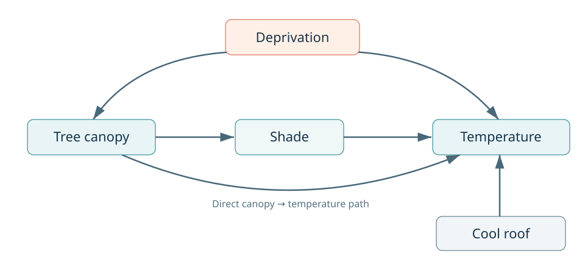
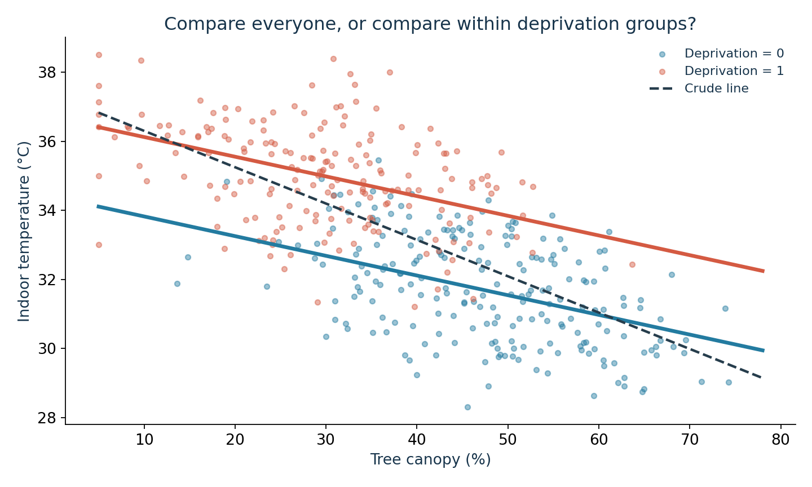
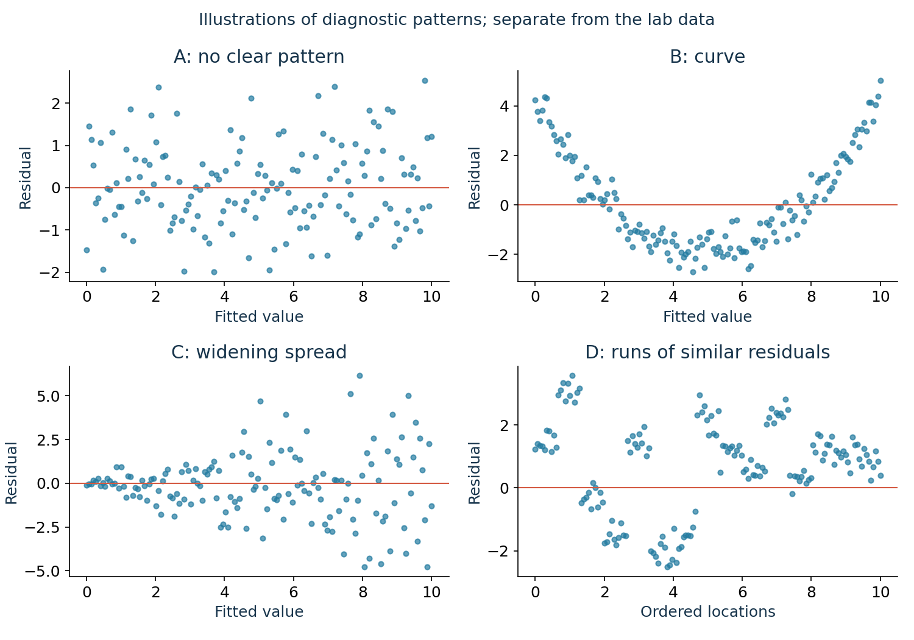
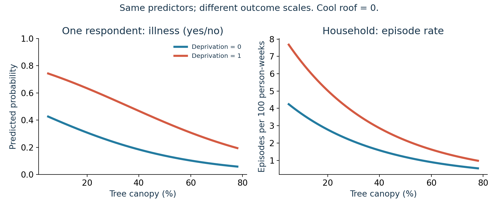

```{r}
#| label: setup
#| include: false
d <- read.csv("data/urban_heat.csv")
source("R/helpers.R")
m0 <- lm(indoor_temp_c ~ canopy10, data = d)
m1 <- lm(indoor_temp_c ~ canopy10 + deprivation, data = d)
m2 <- lm(indoor_temp_c ~ canopy10 + deprivation + cool_roof, data = d)
logit_model <- glm(heat_illness ~ canopy10 + deprivation + cool_roof,
                   family = binomial(link = "logit"), data = d)
count_model <- glm(heat_episodes ~ canopy10 + deprivation + cool_roof +
                     offset(log(person_weeks)),
                   family = poisson(link = "log"), data = d)
```

::: big-idea
The diagram tells us which comparisons we need. Regression estimates those comparisons on a scale appropriate for the outcome.
:::

## Our route through the week

By the end of the week, you should be able to choose a model from the **outcome**, translate a causal diagram into an adjustment set, interpret continuous and binary predictors, and identify a diagnostic concern and a sensible next step.

| Class | Sequence | Hands-on work |
|----|----|----|
| 1 · 75 min | Diagram → linear model → interpretation → diagnostics → logistic bridge | Lab 1, minutes 40–65 |
| 2 · 75 min | Logistic interpretation → practice → Poisson rates → practice → synthesis | Lab 2A, minutes 20–35; Lab 2B, minutes 48–63 |

Our goal is reasoning about models. You do not need to derive the equations or memorize R syntax.

## Class 1 · Start with a question, not a formula

<p class="time">

CLASS 1 · 0–5 MIN · RETRIEVAL AND THE RESEARCH QUESTION

</p>

**Question:** Does greater residential tree canopy reduce indoor heat?

Before opening R, identify the outcome, exposure, unit of observation, exposure contrast, and target effect. Here: one household, indoor temperature in °C, tree canopy around the home, and a **10 percentage point** increase in canopy. Our target is the **total effect**, including pathways through shade.

**Think, then discuss:** If deprivation causes both lower canopy and higher indoor temperature, which path prevents a crude comparison from answering our causal question? Would adjusting for shade help estimate the total effect?

::: callout-note
### One teaching study, three outcomes

We will use **400 simulated households**, each with one respondent. The outcomes are indoor temperature (continuous), that respondent's heat illness during a fixed summer window (0/1), and household heat illness episodes during varying observation periods (count). Episodes may recur. These are invented data, with simplified relationships, not evidence about a real city. Each household is treated as independent for this week's exercises.
:::

## The DAG becomes a modeling decision

<p class="time">

CLASS 1 · 5–12 MIN · IDENTIFICATION BEFORE ESTIMATION

</p>



The open backdoor path is **canopy ← deprivation → temperature**. Adjusting for deprivation blocks it in this working DAG. Shade is a mediator; including it changes the question. Cool roof predicts temperature but does not cause canopy in our simulated study. It is optional for precision, not required to block the canopy backdoor path.

| Decision | Reason | Model consequence |
|----|----|----|
| Include deprivation | Blocks an open backdoor path | Add `+ deprivation` |
| Omit shade for the total effect | Keep the pathway through shade open | Do not add `shade_index` |
| Optionally include cool roof | Predicts temperature; independent of canopy in this simulation | Add `+ cool_roof` for a more precise comparison |
| Do not add every available variable | Mediators and colliders can change or bias the target comparison | Decide from the DAG and question |

A collider example, separate from our main DAG: **canopy → study participation ← heat illness**. Restricting to participants can open a noncausal path. A regression table cannot diagnose this selection problem.

**DAGitty connection:** Mark canopy as the exposure and temperature as the outcome. Under this DAG, the minimal adjustment set is `{deprivation}`. DAGitty selects variables; it does not select the functional form or validate your arrows.

## A linear model is an average comparison

<p class="time">

CLASS 1 · 12–22 MIN · CONTINUOUS AND BINARY PREDICTORS

</p>

For a continuous outcome, linear regression describes how the **mean outcome** varies with the predictors. Ordinary least squares chooses coefficients that minimize squared vertical prediction errors. A residual is **observed minus fitted**.

Only one equation is needed for orientation:

**Mean temperature = baseline + b₁ × canopy10 + b₂ × deprivation + b₃ × cool roof.**

`canopy10 = canopy_pct / 10`: a one-unit increase means **10 percentage points more canopy**, such as 20% to 30%. That is not a 10% relative increase; 20% to 22% is a 10% relative increase.

```{r}
#| label: linear-fit
m2 <- lm(indoor_temp_c ~ canopy10 + deprivation + cool_roof, data = d)
```

Read the coefficient table in the outcome’s units:

```{r}
#| label: linear-table
#| echo: false
knitr::kable(coef_table(m2), digits = 3,
             col.names = c("Term", "Estimate", "95% lower", "95% upper"))
```

| Term | How to read it |
|----|----|
| `canopy10` ≈ −0.57 | At the same deprivation category and roof status, 10 percentage points more canopy is associated with **0.57°C lower mean indoor temperature**. |
| `deprivation` ≈ +2.32 | Category 1 households have a fitted mean about **2.32°C higher** than category 0 households with the same canopy and roof status. |
| `cool_roof` ≈ −1.37 | Homes with a cool roof (1) have a fitted mean about **1.37°C lower** than homes without one (0), at the same canopy and deprivation. |
| Intercept ≈ 34.92 | Fitted mean when canopy is 0%, deprivation is 0, and cool roof is 0. The data start at 5% canopy; this baseline is extrapolated. |

The coefficient of deprivation is not automatically a causal effect of deprivation. The adjustment set was selected for the **canopy** question; causal questions about other predictors need their own DAGs.

### A binary predictor is a group comparison

```{r}
#| label: binary-fit
roof_only <- lm(indoor_temp_c ~ cool_roof, data = d)
aggregate(indoor_temp_c ~ cool_roof, data = d, FUN = mean)
coef(roof_only)
```

Without other predictors, the intercept is the mean for roof = 0 (about 33.78°C), and the roof coefficient is **mean(roof = 1) − mean(roof = 0)** (about −1.36°C). With adjustment, it is a conditional group difference. For three or more categories, use a factor and compare each category with a stated reference; do not assume category codes 1, 2, 3 are equally spaced quantities.

**Quick check:** Does a binary predictor require logistic regression? **No. The outcome selects the family.** A continuous temperature outcome can have a binary roof predictor in a linear model.

### What is held constant?

We compare model predictions for the same values of the other included variables. The model does not physically hold anything constant, nor does it guarantee comparable homes exist at every predictor combination.

The additive model above assumes the canopy slope is the same for roof = 0 and roof = 1. A moderator requires an **interaction**, for example `canopy10 * cool_roof`. Then the canopy coefficient is the slope for roof = 0, and the interaction is the slope difference for roof = 1. Practice with interactions is optional after class.

## Why the estimate changes after adjustment

<p class="time">

CLASS 1 · 22–30 MIN · CONFOUNDING INTUITION

</p>

Predict the direction first. In this study, more deprived households tend to have **less canopy** and **higher temperatures**. Mixing those households with less deprived households makes the crude cooling association look stronger than the within-group association.



```{r}
#| label: adjustment-comparison
comparison <- data.frame(
  model = c("Crude", "Adjust deprivation", "Also include cool roof"),
  canopy_slope = c(coef(m0)["canopy10"], coef(m1)["canopy10"],
                   coef(m2)["canopy10"]))
comparison
```

Here the estimate changes from about **−1.05** to **−0.57°C per 10 percentage points** after adjusting for deprivation. Adding cool roof barely changes the estimate and improves precision. Adjustment can increase, decrease, or reverse an estimate; there is no rule that adjusted estimates must be smaller.

::: callout-warning
### The decision comes from the diagram

A changed coefficient is not proof of confounding, and an unchanged coefficient does not prove its absence. Do not choose controls using p-values, stepwise selection, the largest R², or a mechanical percent-change rule. A well-fitting model can answer the wrong causal question.
:::

**What if we add shade?** We block part of the effect we said we wanted. The canopy coefficient moves toward the direct pathway in this particular simulation. A direct-effect interpretation generally requires additional causal assumptions; it does not follow just from adding a mediator.

## A coefficient is an estimate, not a verdict

<p class="time">

CLASS 1 · 30–33 MIN · UNCERTAINTY

</p>

The adjusted canopy coefficient is approximately −0.57°C, with a model-based 95% interval of about **−0.67 to −0.47°C**. Report the estimate, interval, unit, comparison, and adjustment set.

A standard error describes sampling uncertainty about the coefficient. A confidence interval does not account for all uncertainty in the DAG, measurement, selection, or functional form. Under repeated sampling and the method's assumptions, 95% intervals made this way cover the target parameter about 95% of the time.

A p-value describes compatibility with a particular null model. A small p-value does not establish causation or practical importance. A confidence interval for a **mean** and a prediction interval for **one new household** answer different questions; an individual prediction is usually less precise.

## Check the comparison and the model

<p class="time">

CLASS 1 · 33–40 MIN · ASSUMPTIONS AND DIAGNOSTICS

</p>

Two questions matter: **Did we identify the intended comparison?** and **Does this model describe it adequately?** Diagnostic plots help with the second question; they do not establish the first.

| Concern | What to inspect | What it suggests doing |
|----|----|----|
| Causal identification | DAG, timing, measurement, selection, plausible unmeasured causes | Revise the design or limit the claim; a residual plot cannot prove no confounding |
| Overlap / positivity | Compare canopy distributions across deprivation groups | Avoid unsupported contrasts and extrapolation; define a population with support |
| Conditional mean shape | Residuals vs fitted values and vs continuous predictors | A curve suggests a missing nonlinear term or interaction; reconsider the mean model |
| Constant error variance | Residual spread across fitted values | A funnel can make ordinary SEs unreliable; HC3 robust SEs address heteroskedastic inference under appropriate independence assumptions |
| Independence | Sampling design; residuals ordered in time or mapped in space | Neighbors or repeated observations may need spatial, clustered, or hierarchical methods |
| Residual normality | Q–Q plot, especially tail departures | Relevant for exact small-sample normal-theory inference; Y and X need not themselves be normal |
| Influence and collinearity | Cook's distance; sparse categories; redundant or strongly correlated predictors | Check data and sensitivity; do not delete observations automatically |

No perfect multicollinearity is allowed. Strong, imperfect collinearity can make estimates unstable and intervals wide; it is not the same as confounding.



**Ask students:** Which plot suggests changing the mean model? Which suggests changing how we estimate uncertainty? Which requires information about location or sampling? Why would a normality test of tree canopy answer the wrong question?

Robust SEs change uncertainty, not the fitted OLS coefficients. They do not fix omitted confounders, a curved mean relationship, or spatial dependence. Normal residuals are not required simply to compute an OLS line.

## Pause for Lab 1

<p class="time">

CLASS 1 · 40–65 MIN · GUIDED PAIR WORK

</p>

Open **02_lab_linear.qmd** or its HTML version. One partner runs code; the other explains each result before the pair writes an answer. Switch roles halfway through. If on Zoom, use breakout rooms and keep one shared answer document.

**Return with:** one DAG-based adjustment decision, a continuous-predictor interpretation, a binary-predictor interpretation, the crude-versus-adjusted comparison, and one diagnostic judgment. The optional exercises are for after class.

## Bridge: what if the outcome is yes/no?

<p class="time">

CLASS 1 · 65–75 MIN · THE FIRST GLM

</p>

Our new outcome is `heat_illness`: did **one respondent** report heat illness during the same fixed summer window? 1 = yes, 0 = no.

The predictors can stay the same. The outcome scale changes. A straight-line probability model can predict below 0 or above 1 and has nonconstant binary-outcome variance. Logistic regression uses an S-shaped probability curve that stays between 0 and 1. Linear probability models also exist; we are learning logistic regression for this setting.

| Outcome | Family and link | What the model describes |
|----|----|----|
| Temperature in °C | Linear model, identity link | Mean temperature |
| Illness, 0/1 | Binomial family, logit link | Probability of illness through log-odds |
| Episodes, 0, 1, 2, … | Poisson family, log link | Expected count; a rate when exposure is included |

A GLM combines an outcome distribution with a **link** connecting its mean to an additive predictor score. You need to understand the output scale; you do not need to memorize the link formula.

```{r}
#| label: first-logistic
logit_model <- glm(heat_illness ~ canopy10 + deprivation + cool_roof,
                   family = binomial(link = "logit"), data = d)
coef_table(logit_model, exponentiate = TRUE)
```

Logistic slope coefficients are in **log-odds**. Exponentiating them gives **odds ratios**. The exponentiated intercept is baseline odds, rather than a contrast between groups; here it refers to an extrapolated 0% canopy profile. We will interpret these and calculate probabilities at the start of the next class.

**Exit check:** (1) What chooses the family: the outcome or predictor? (2) What variable blocks the canopy backdoor path? (3) If `exp(b) = 0.70`, can we say the probability is 30% lower? Bring your explanation next time.

## Class 2 · Retrieve before adding complexity

<p class="time">

CLASS 2 · 0–8 MIN · RECONNECT THE THREE SCALES

</p>

Take one minute to answer yesterday's exit check without notes, then compare with a partner.

For the GLM exercises we use a simplified outcome-specific DAG: **deprivation → canopy; deprivation → outcome; canopy → outcome; cool roof → outcome**. Canopy is the exposure; deprivation remains the required adjustment variable. The measured shade index belongs to the temperature example. The simulated outcomes were generated separately to make the model scales clear; this is not a fitted biological sequence from temperature to illness to episodes.

The target for logistic regression is an adjusted association on an odds scale, with a conditional causal interpretation only if the DAG, design, overlap, and model assumptions are justified. The count model targets a household episode rate comparison at a given deprivation category and roof status.

## Odds ratios and probabilities tell different stories

<p class="time">

CLASS 2 · 8–20 MIN · LOGISTIC INTERPRETATION

</p>

**Probability:** events divided by all possible outcomes. **Odds:** events divided by non-events. If p = 0.20, odds = 0.20 / 0.80 = 0.25. Odds are not probabilities.

In our fitted model, the canopy coefficient is about −0.340 on the log-odds scale. `exp(-0.340)` is about **0.712**: 10 percentage points more canopy is associated with **28.8% lower odds** of respondent illness, at the same deprivation and roof status. A ratio of 1 is the null comparison. The 95% OR interval is about **0.573 to 0.883**.

For a binary predictor, compare 1 with 0. The cool-roof OR is about **0.393**, holding canopy and deprivation constant. This is an odds comparison, not a percentage point difference.

### Translate back to a probability

```{r}
#| label: predicted-probabilities
homes <- data.frame(canopy10 = c(2, 4), deprivation = 0, cool_roof = 0)
homes$probability <- predict(logit_model, newdata = homes, type = "response")
homes
```

For deprivation = 0 and roof = 0, the fitted illness probabilities at **20% and 40% canopy** are about **30.8% and 18.4%**. The difference is about **−12.4 percentage points**. These are model predictions for two specified profiles, not observed group means or population-wide marginal effects. We have not calculated uncertainty for this probability difference.

The odds ratio for 20 additional percentage points is `0.712^2`, about 0.506. The probability change depends on the starting profile. In an additive logistic model, a constant odds ratio can correspond to different probability differences across groups; that alone does not establish an interaction in the log-odds model.



::: callout-warning
### A GLM-specific adjustment caution

An odds ratio can change when another outcome predictor is added even without confounding. This is called **non-collapsibility**. Compare the model's target and predictions; do not treat a change in an OR as proof that a new variable was a confounder.
:::

## Lab 2A · Fit, interpret, predict

<p class="time">

CLASS 2 · 20–35 MIN · LOGISTIC PRACTICE

</p>

Open **03_lab_glm.qmd**, Part A. Confirm coding, fit the model, interpret one OR and interval, calculate two probabilities, and inspect a small calibration table. Explain why the OR and probability difference have different numerical values.

## Counts: how many episodes, over how much exposure?

<p class="time">

CLASS 2 · 35–48 MIN · POISSON REGRESSION

</p>

`heat_episodes` counts household heat illness episodes. Zero is a valid count; episodes can recur. The observation windows and household sizes differ, so households contribute different **person-weeks**.

Four episodes over 100 person-weeks and two episodes over 20 person-weeks are different comparisons from four versus two episodes alone. Their observed rates are 4 and 10 per 100 person-weeks.

Poisson regression uses a **log link** so expected counts are positive. Exponentiating a coefficient gives a multiplicative comparison. With an exposure offset, it is an **incidence rate ratio (IRR)** for episodes.

```{r}
#| label: first-poisson
count_model <- glm(heat_episodes ~ canopy10 + deprivation + cool_roof +
                     offset(log(person_weeks)),
                   family = poisson(link = "log"), data = d)
coef_table(count_model, exponentiate = TRUE)
```

`offset(log(person_weeks))` gives the model the amount of observation opportunity. Its coefficient is fixed at 1, rather than estimated. Doubling person-weeks doubles the model's expected count at the same covariate profile. The offset assumes episode counts are proportional to exposure; it is neither an ordinary confounder adjustment nor a guarantee this proportionality is correct.

**Model the count and supply exposure.** Do not put a precomputed noninteger rate on the left of a Poisson count model. Here `person_weeks > 0` for everyone. A raw count model without an offset is appropriate when exposure is equal or when the scientific target is explicitly a count rather than an exposure-adjusted rate.

### Interpret the multiplier

The canopy coefficient is about −0.282. Its exponent is **0.754**: 10 percentage points more canopy is associated with an estimated **24.6% lower episode rate**, comparing the same deprivation category and roof status. The model-based 95% IRR interval is about **0.688 to 0.827**.

A roof coefficient also compares roof = 1 with roof = 0. Here its IRR is about **0.655**. Exponentiating the intercept gives a baseline rate per person-week, not an odds ratio or a group difference.

```{r}
#| label: count-predictions
profiles <- data.frame(canopy10 = c(2, 4), deprivation = 0,
                       cool_roof = 0, person_weeks = 100)
profiles$expected_episodes <- predict(count_model, newdata = profiles,
                                      type = "response")
profiles
```

At 100 person-weeks, the predicted counts are about **2.78 and 1.58 episodes**. These are also rates per 100 person-weeks because we chose that exposure. Expected counts may be fractional even though observed counts are whole numbers.

## Lab 2B · Rates and a diagnostic decision

<p class="time">

CLASS 2 · 48–63 MIN · POISSON PRACTICE

</p>

Continue **03_lab_glm.qmd**, Part B. Fit the count model with an offset, interpret an IRR, compare predicted counts at different exposures, and check conditional dispersion. Explain what changing the exposure changes and what it leaves unchanged.

## GLM diagnostics: keep the causal checks, change the outcome checks

<p class="time">

CLASS 2 · 63–71 MIN · CHOOSE A RESPONSE TO A PROBLEM

</p>

| Model | Check | Interpretation and response |
|----|----|----|
| Logistic | Confirm 0/1 coding and which outcome is 1 | The model estimates P(Y = 1); reversing coding reverses the interpretation |
| Logistic | Convergence warnings; very large coefficients or SEs; sparse cross-tabulations | Possible separation or instability. Inspect data and get help with a suitable remedy; do not report huge ORs uncritically |
| Logistic | Observed proportions vs predicted probabilities; plausible continuous-predictor shape | Big systematic mismatches suggest a poor mean model. The additive relationship is in **log-odds**, not in probability; small-bin noise is expected |
| Poisson | Counts, positive exposure, offset, residual pattern | Check the measurement and the log-mean form; investigate systematic mismatch |
| Poisson | Pearson residual sum of squares / residual df | A value well above 1 suggests extra **conditional** variation; inspect the cause and consider quasi-Poisson or negative binomial methods |
| Both | Influence, overlap, missingness, dependence, measurement and DAG | These concerns remain; no normality requirement for raw Y, and binary/count residuals are not expected to be normally distributed |

In a Poisson model, variance equals the mean **conditional on the predictors and exposure**. A marginal count variance larger than its marginal mean is not enough to diagnose overdispersion. The Pearson ratio is a rough screen, not a hard pass/fail cutoff, especially with sparse counts.

Our main count data give a ratio near **0.97**; the deliberately more variable `episodes_extra` outcome gives about **1.79**. Quasi-Poisson retains the same log-mean specification and typically changes uncertainty; it does not cure a wrong mean model or unmeasured confounding. Negative binomial introduces a different variance model. Neither automatically fixes dependence.

## Bring the scales back together

<p class="time">

CLASS 2 · 71–75 MIN · EXIT CHECK AND NEXT WEEK

</p>

| Feature | Linear | Logistic | Poisson with exposure offset |
|----|----|----|----|
| Outcome | Continuous | Binary 0/1 | Nonnegative integer count |
| Default interpretation of b | Difference in mean Y | Difference in log-odds | Difference in log-rate |
| Interpret `exp(b)`? | Usually no | Odds ratio | Rate ratio |
| Null on the reported scale | 0 for a difference | 1 for an OR | 1 for an IRR |
| `predict(..., type = "response")` | Mean outcome (or `predict.lm`) | Probability | Expected count for the supplied exposure |
| Does the family establish causality? | No | No | No |

**Submit a three-sentence exit ticket:**

1.  Choose a model for average temperature, any respondent illness, and household episode count; say why.
2.  Explain the difference between −0.57°C, OR = 0.71, and IRR = 0.75 for the same 10 percentage point canopy contrast.
3.  Suppose residuals cluster among neighboring neighborhoods, or households are repeatedly observed within the same neighborhood. Which assumption is threatened, and what information would you need next?

Next week, spatial models will address geographic dependence and hierarchical models will address grouping and repeated observations. A correct outcome family is one part of a complete geographic research model.

## Readings and where they connect

This lecture uses original teaching examples and simulations. The following readings supply the conceptual background; no text or data have been reproduced from them.

- Nick Huntington-Klein, [The Effect, Chapter 13: Regression](https://theeffectbook.net/ch-StatisticalAdjustment.html). Focus on coefficient interpretation, adjustment, functional form, and the sections on standard errors and additional regression concerns. Its discussion of causal design motivates our DAG-first approach.
- [Introduction to Modern Statistics, Chapter 24](https://openintro-ims.netlify.app/inf-model-slr): uncertainty and conditions for a single-predictor linear model.
- [Chapter 25](https://openintro-ims.netlify.app/inf-model-mlr): adjusted linear comparisons and inference.
- [Chapter 26](https://openintro-ims.netlify.app/inf-model-logistic): logistic inference and model conditions.
- Poisson regression and offsets are an instructor-provided extension beyond these assigned OpenIntro chapters. See the official R documentation for [`glm`](https://stat.ethz.ch/R-manual/R-devel/library/stats/html/glm.html), [families and links](https://stat.ethz.ch/R-manual/R-devel/library/stats/html/family.html), and [`offset`](https://stat.ethz.ch/R-manual/R-devel/library/stats/html/offset.html).
