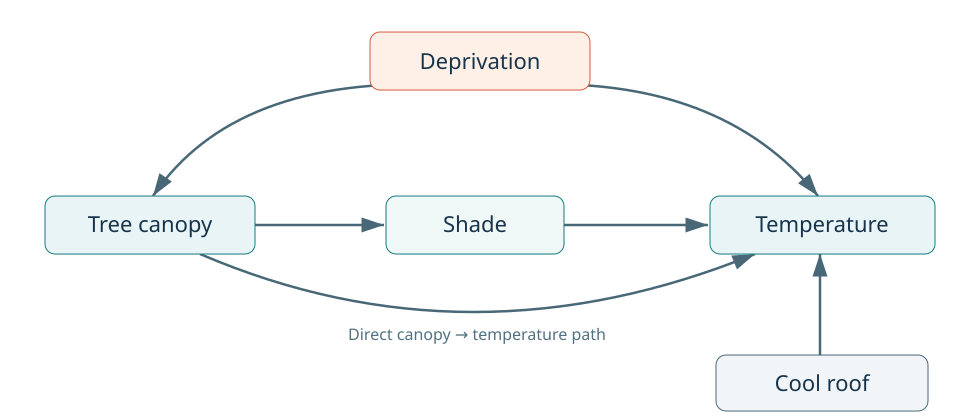

## Before you start

**Goal:** Use a causal diagram to choose a comparison, fit a linear model, interpret continuous and binary predictors, and identify a diagnostic concern. Use the supplied code; write explanations in your own words. You are not being assessed on typing code from memory.

Open `GEOG531_Regression_Week` as your RStudio project (double-click `GEOG531_Regression_Week.Rproj`). Open this `.qmd` and run the setup chunk, then run each chunk in order using the green arrow. To make an HTML document, choose **Render**. The rendered HTML is a reading copy; its code must be run in RStudio to change results.

If you see “cannot open file,” check that the project is open and the `data` and `R` folders are present. All data are local. Before class, run `R/install_packages.R` once to install `tidyverse`, `broom` and the rendering packages. The optional extensions use `infer`, `lmtest` and `sandwich`. Use R 4.1 or newer for the `|>` pipe. Rendering also requires Quarto.

```{r}
#| label: setup
library(tidyverse)
library(broom)

d <- read_csv("data/urban_heat.csv", show_col_types = FALSE) |>
  mutate(canopy10 = canopy_pct / 10)

d |>
  select(household_id, canopy_pct, deprivation, cool_roof, indoor_temp_c) |>
  slice_head(n = 6)
```

There are 400 **simulated** households. `canopy_pct` ranges from 5% to 78%; `canopy10 = canopy_pct / 10`. `deprivation` is 0 = lower, 1 = higher; `cool_roof` is 0 = absent, 1 = present. These coarse categories are teaching devices, not validated measures. The measured shade index is a mediator in the working temperature DAG.

### A small vocabulary for this lab

`|>` means “take the result and pass it to the next step.” `lm()` and `glm()` fit models; `broom` puts their results into tibbles.

| Function | Read it as |
|----|----|
| `mutate()` | Create or change a column |
| `filter()` / `select()` | Keep rows / keep columns |
| `group_by()` + `summarise()` | Compare group summaries |
| `tidy()` | One row per model coefficient |
| `augment()` | Add fitted values and diagnostics to observations |
| `ggplot()` | Plot the tibble |

Use the code as a recipe. Concentrate on what the comparison means. `conf.low` and `conf.high` are the two ends of a 95% interval. `factor()` in the overlap plot only labels the deprivation groups; the models retain the original 0/1 coding.

## 1 · Decide before fitting · 3 minutes



**Q1.** State the exposure, outcome, unit of analysis, contrast, and target effect. Which variable is required to block the backdoor path? Should shade be included for the total effect? Explain each choice in one sentence.

::: answer-space
**Your answer:**
:::

## 2 · Predict, then compare crude and adjusted models · 6 minutes

**Q2a. Before running:** Do you expect the crude canopy association to look more or less strongly cooling than the deprivation-adjusted association? Use the directions of the arrows and relationships in the lecture.

```{r}
#| label: fit-linear
m0 <- lm(indoor_temp_c ~ canopy10, data = d)
m1 <- lm(indoor_temp_c ~ canopy10 + deprivation, data = d)

comparison <- bind_rows(
  tidy(m0, conf.int = TRUE) |> mutate(model = "Crude"),
  tidy(m1, conf.int = TRUE) |> mutate(model = "Adjust deprivation")
) |>
  filter(term == "canopy10") |>
  select(model, estimate, conf.low, conf.high)

comparison
```

**Q2b.** Report both coefficients. Explain why they differ using the backdoor path, rather than saying only “the coefficient changed.” Does a change alone prove that deprivation is a confounder?

```{r}
#| label: fit-precision
m2 <- lm(indoor_temp_c ~ canopy10 + deprivation + cool_roof, data = d)

linear_results <- tidy(m2, conf.int = TRUE) |>
  select(term, estimate, conf.low, conf.high)

linear_results
```

**Q2c.** What changes when cool roof is added? Is it required to block the canopy backdoor path in the supplied DAG? If time permits, compare the canopy interval in `comparison` with the canopy row of `linear_results`.

::: answer-space
**Your answers:**
:::

## 3 · Read a continuous coefficient and uncertainty · 4 minutes

**Q3.** Using `m2`, complete this sentence with numbers and units:

“At the same \_\_\_\_\_\_ and \_\_\_\_\_\_, a \_\_\_\_\_\_ percentage point increase in canopy is associated with an estimated \_\_\_\_\_\_°C difference in mean indoor temperature (95% CI \_\_\_\_\_\_ to \_\_\_\_\_\_).”

Do not exponentiate this coefficient. What mean temperature difference would the model imply for a change from 20% to 40% canopy? Why is “the causal effect is proven” too strong?

::: answer-space
**Your answer:**
:::

## 4 · A binary predictor is a comparison to a reference · 4 minutes

```{r}
#| label: roof-comparison
d |>
  group_by(cool_roof) |>
  summarise(n = n(), mean_temp_c = mean(indoor_temp_c), .groups = "drop")

roof_only <- lm(indoor_temp_c ~ cool_roof, data = d)

tidy(roof_only, conf.int = TRUE) |>
  select(term, estimate, conf.low, conf.high)
```

**Q4a.** Which group does the intercept describe? Subtract the two group means in the right order to reproduce the `cool_roof` coefficient. What does a negative value mean?

**Q4b.** Now read the `cool_roof` row of `linear_results`. Write its **adjusted** interpretation. Why can this linear model include a binary predictor?

::: answer-space
**Your answers:**
:::

## 5 · Inspect, then decide · 6 minutes

```{r}
#| label: linear-diagnostic-plots
#| fig-cap: "Residuals versus fitted temperature."
linear_diagnostics <- augment(m2, data = d)

linear_diagnostics |>
  ggplot(aes(x = .fitted, y = .resid)) +
  geom_point(alpha = 0.5, color = "#237ba0") +
  geom_hline(yintercept = 0, linetype = "dashed") +
  geom_smooth(method = "loess", se = FALSE, color = "#d45a42") +
  labs(x = "Fitted temperature (°C)", y = "Residual (°C)") +
  theme_minimal()
```

```{r}
#| label: linear-qq-plot
#| fig-cap: "Normal Q–Q plot of standardized residuals."
linear_diagnostics |>
  ggplot(aes(sample = .std.resid)) +
  stat_qq(color = "#237ba0", alpha = 0.6) +
  stat_qq_line(color = "#d45a42") +
  labs(x = "Theoretical normal quantile", y = "Standardized residual") +
  theme_minimal()
```

```{r}
#| label: overlap-check
d |>
  mutate(deprivation_group = factor(
    deprivation, levels = c(0, 1), labels = c("Lower (0)", "Higher (1)"))) |>
  ggplot(aes(x = deprivation_group, y = canopy_pct)) +
  geom_boxplot(outlier.shape = NA) +
  geom_jitter(width = 0.12, alpha = 0.25, color = "#237ba0") +
  labs(x = "Deprivation", y = "Tree canopy (%)") +
  theme_minimal()
```

**Q5a.** Is there a clear curve or funnel in the residual plot? Are Q–Q departures extreme? Use cautious language: diagnostic plots can reveal problems but cannot prove a model is correct.

**Q5b.** Do canopy values overlap between deprivation groups? Why would predicting high-deprivation homes at 90% canopy be a concern even if the regression prints an answer?

**Q5c.** Which of these concerns cannot be established from these plots alone: unmeasured confounding, a curved mean relationship, or spatial independence? What would you need to assess the ones that plots alone cannot establish?

**Hand in:** Your Q1–Q5 answers and the coefficient table from `m2`. A short explanation is more useful than pasting the full `summary()` output. Switch driver and interpreter roles after Q2.

## Optional extensions · outside the 25-minute core

### A · Add a mediator and notice the changed question

```{r}
#| label: mediator-extension
m_shade <- lm(indoor_temp_c ~ canopy10 + deprivation + cool_roof + shade_index,
              data = d)

tidy(m_shade, conf.int = TRUE) |>
  filter(term == "canopy10") |>
  select(term, estimate, conf.low, conf.high)
```

How did the canopy coefficient change? Which pathway did you block? Explain why the smaller coefficient does not show the previous model was “wrong.” Under what additional assumptions might a direct-effect interpretation be defensible?

### B · Robust standard errors

Run this optional chunk interactively after installing the two optional packages. It is skipped during rendering.

```{r}
#| label: robust-extension
#| eval: false
# Install these optional packages once if needed:
# install.packages(c("lmtest", "sandwich"))

bind_rows(
  tidy(m2, conf.int = TRUE) |> mutate(uncertainty = "Ordinary"),
  lmtest::coeftest(m2, vcov. = sandwich::vcovHC(m2, type = "HC3")) |>
    tidy(conf.int = TRUE) |>
    mutate(uncertainty = "HC3 robust")
) |>
  filter(term == "canopy10") |>
  select(uncertainty, estimate, std.error, conf.low, conf.high)
```

Which numbers stay the same? Which can change? Explain why this does not solve unmeasured confounding, misspecified mean relationships, or spatial dependence.

### C · Connect a moderator to an interaction

```{r}
#| label: interaction-extension
m_interaction <- lm(indoor_temp_c ~ canopy10 * cool_roof + deprivation, data = d)

tidy(m_interaction, conf.int = TRUE) |>
  select(term, estimate, conf.low, conf.high)
```

The canopy slope for roof = 0 is the `canopy10` coefficient. For roof = 1, add the `canopy10:cool_roof` coefficient. What comparison does that interaction estimate? Do not infer an interaction simply because one group has p \< .05 and another does not. This simulation was generated with no true canopy-by-roof interaction.

### D · Influence

```{r}
#| label: influence-extension
augment(m2, data = d) |>
  select(household_id, .cooksd, .hat, .std.resid) |>
  slice_max(order_by = .cooksd, n = 5, with_ties = FALSE)
```

Identify observations for investigation. Why would deleting the five largest values automatically be a poor rule?

### E · Optional bootstrap intuition with infer

This extension is outside class time. It resamples **household rows** and recalculates the **crude** canopy slope. It illustrates sampling variability; resampling does not block the deprivation backdoor path. Run the chunk interactively when ready. It is skipped during rendering so the core lab does not require `infer`.

```{r}
#| label: infer-bootstrap-extension
#| eval: false
# install.packages("infer")  # once, if needed
set.seed(531)

bootstrap_slopes <- d |>
  infer::specify(indoor_temp_c ~ canopy10) |>
  infer::generate(reps = 1000, type = "bootstrap") |>
  infer::calculate(stat = "slope")

bootstrap_slopes |>
  ggplot(aes(x = stat)) +
  geom_histogram(bins = 30, fill = "#237ba0", color = "white") +
  labs(x = "Bootstrap crude slope (°C per 10 percentage points)", y = "Samples") +
  theme_minimal()

bootstrap_slopes |>
  infer::get_confidence_interval(level = 0.95, type = "percentile")
```

Why would a narrow bootstrap interval around the crude association still leave the confounding problem unresolved? Row bootstrapping assumes independent observations; spatial or grouped data would require an appropriate resampling design.

Package documentation: [broom model tidiers](https://broom.tidymodels.org/), [dplyr](https://dplyr.tidyverse.org/), [ggplot2](https://ggplot2.tidyverse.org/), and [infer](https://infer.tidymodels.org/).
