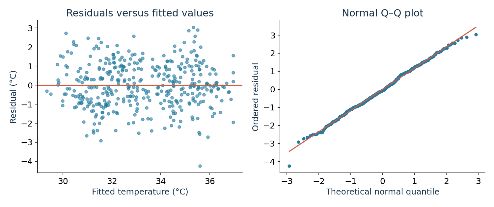
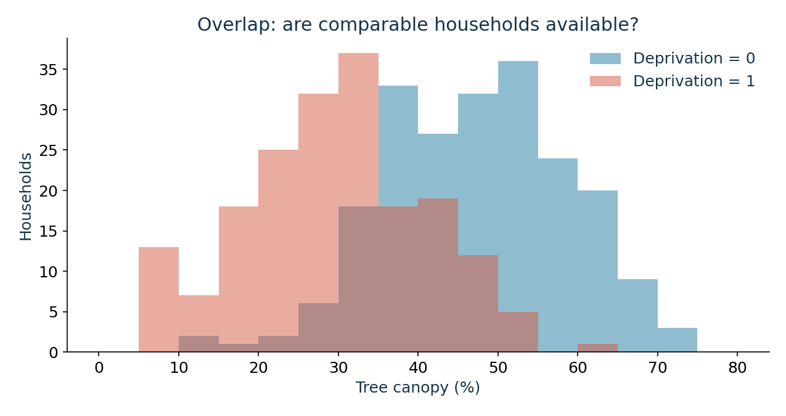

```{r}
#| label: key-setup
#| include: false
library(tidyverse)
library(broom)
d <- read_csv("data/urban_heat.csv", show_col_types = FALSE) |>
  mutate(canopy10 = canopy_pct / 10)
m0 <- lm(indoor_temp_c ~ canopy10, data = d)
m1 <- lm(indoor_temp_c ~ canopy10 + deprivation, data = d)
m2 <- lm(indoor_temp_c ~ canopy10 + deprivation + cool_roof, data = d)
logit_model <- glm(heat_illness ~ canopy10 + deprivation + cool_roof,
                   family = binomial(link = "logit"), data = d)
count_model <- glm(heat_episodes ~ canopy10 + deprivation + cool_roof +
                     offset(log(person_weeks)), family = poisson(link = "log"), data = d)
```

## Lab 1 · Q1: from DAG to model

The exposure is residential canopy; the outcome is indoor temperature; each row is a household. The contrast is 10 percentage points more canopy, and the target is the total effect, including shade. Deprivation is required to block **canopy ← deprivation → temperature**. Exclude shade because it is a mediator of the target total effect. Cool roof is an optional outcome predictor under this simulated DAG.

Associational wording is appropriate for the fitted results. A causal interpretation additionally relies on a correct causal structure, no relevant unmeasured confounding, suitable measurement and selection, sufficient support, and an adequate model.

## Lab 1 · Q2: adjustment

**Q2a:** Predict a more strongly negative crude slope: deprived households have both less canopy and hotter homes.

**Q2b:** The crude canopy slope is **−1.053°C** per 10 percentage points; the deprivation-adjusted slope is **−0.571°C**. The crude comparison mixes a canopy contrast with a deprivation contrast. The causal diagram motivates the adjustment; coefficient change alone does not prove confounding.

**Q2c:** With roof added, the canopy slope is **−0.568°C**, essentially the same, with a narrower interval. Roof is not a required adjustment variable for the canopy total effect in this DAG. It helps explain temperature variation.

```{r}
#| label: key-linear-tables
tidy(m1, conf.int = TRUE) |> select(term, estimate, conf.low, conf.high)
tidy(m2, conf.int = TRUE) |> select(term, estimate, conf.low, conf.high)
```

## Lab 1 · Q3: continuous predictor

“At the same **deprivation category** and **roof status**, a **10 percentage point** increase in canopy is associated with an estimated **−0.568°C** difference in mean indoor temperature (95% CI approximately **−0.668 to −0.467°C**).” Equivalently: 0.568°C lower, with the cooling magnitude between 0.467 and 0.668°C.

A change from 20% to 40% canopy is two units of `canopy10`; the mean difference is **2 × −0.568 ≈ −1.135°C** under the constant-slope model. An observational regression does not prove causal identification. The interval does not include unmeasured-confounding uncertainty.

## Lab 1 · Q4: binary predictor

**Q4a:** Roof = 0 is the reference group. Its mean is about **33.783°C**; the roof = 1 mean is about **32.426°C**. Subtracting 1 minus 0 gives **−1.356°C**, the roof-only coefficient. The negative value means lower average temperature for homes with a cool roof.

**Q4b:** In `m2`, roof = 1 homes have an estimated **1.373°C lower mean temperature** than roof = 0 homes at the same canopy and deprivation category (95% interval for the difference approximately **−1.609 to −1.136°C**). A binary predictor is permitted in a linear model; the continuous **outcome** motivates the linear family.

The adjustment set was chosen for canopy, so avoid claiming all coefficients are causally identified solely because they appear together. Roof is exogenous in this simulation, but the broader lesson is to check the causal question separately for each exposure.

## Lab 1 · Q5: diagnostics

**Q5a:** The supplied residual plot has no dominant curve or strong funnel. The Q–Q plot is reasonably close to a line, with ordinary finite-sample departures. This is consistent with the way the data were generated and is not proof of a correct model.



**Q5b:** Both deprivation groups have a substantial range of canopy values in common. At extremes the available support is thinner. Predicting at 90% canopy extrapolates beyond every observed household (maximum 78%). A printed answer does not establish a supported comparison.



**Q5c:** Unmeasured confounding cannot be established or ruled out from residual plots; assess substantive knowledge, study design, timing, measurement and plausible alternative DAGs. Spatial independence cannot be established from these plots alone; location, grouping and sampling information, and appropriate residual dependence checks are needed. A residual plot can reveal a curved mean pattern, although an apparently flat pattern cannot prove that all functional-form choices are adequate.

## Lab 1 · Optional extensions

**Mediator:** Including shade gives a canopy coefficient around **−0.213°C**, rather than −0.568°C. This blocks the pathway through shade. The simulation's true direct slope is −0.25 and total slope is −0.60 per 10 percentage points. Sample estimates need not equal these truths. In real data, mediator adjustment can introduce bias if mediator–outcome confounding is unaddressed; the adjusted coefficient is not automatically a direct causal effect.

**Robust SEs:** The fitted coefficients are identical under ordinary and HC3 uncertainty estimates. The canopy SE is approximately **0.05109 ordinarily** and **0.05092 with HC3**. The small difference is expected here because the simulation has roughly constant error variance. HC3 does not repair confounding or spatial dependence.

**Interaction:** The interaction coefficient estimates the difference between the canopy slope among roof = 1 homes and the slope among roof = 0 homes. The simulation has no true canopy-by-roof interaction; sampling variation can still produce a nonzero fitted interaction. An imprecise nonsignificant interaction does not prove identical effects.

**Influence:** Cook's distance flags observations whose removal would substantially change the fitted coefficients relative to model uncertainty. Investigate measurement, leverage and substantive plausibility; conduct sensitivity analysis where warranted. Ranking alone is not a deletion rule.

## Lab 2 · A1: outcome

The event is **1 = respondent heat illness** during the fixed window. There are **113 events and 287 non-events**. This is one binary respondent outcome per household, not an episode count and not a response per household member. Logistic regression models its probability. A binary predictor does not itself require a binary-outcome family.

## Lab 2 · A2: odds ratios

```{r}
#| label: key-logistic-table
tidy(logit_model, conf.int = TRUE, exponentiate = TRUE) |>
  select(term, estimate, conf.low, conf.high)
```

The canopy OR is about **0.712** (95% profile-likelihood CI **0.571–0.881**). At the same deprivation and roof status, 10 percentage points more canopy is associated with approximately **28.8% lower odds** of respondent illness. The null OR is **1**.

The roof OR is about **0.393** (95% profile-likelihood CI **0.230–0.657**). Roof = 1 is associated with about **60.7% lower odds** than roof = 0, at the same canopy and deprivation. Neither statement is a percentage point difference in probability.

Odds = p/(1−p). Because odds and probability differ, an odds multiplier does not give the same proportional probability change, except as a possible approximation in rare-outcome settings. Students do not need to invoke that approximation here; predicted probabilities are available directly.

## Lab 2 · A3: probabilities

```{r}
#| label: key-logistic-predictions
homes <- tibble(canopy10 = c(2, 4), deprivation = 0, cool_roof = 0)

predicted_homes <- augment(logit_model, newdata = homes,
                           type.predict = "response") |>
  transmute(canopy_pct = canopy10 * 10, deprivation, cool_roof,
            probability = .fitted)

predicted_homes

predicted_homes |>
  arrange(canopy_pct) |>
  summarise(difference_pp = 100 * (last(probability) - first(probability)))
```

20% canopy: **0.3083** or **30.83%**. 40% canopy: **0.1842** or **18.42%**. The second-minus-first difference is **−12.42 percentage points**. Deprivation and roof are both set to 0. These are point predictions for two specified profiles. They are not confidence limits, not the average outcome among observed canopy groups, and not population-standardized marginal effects.

For a 20 percentage point contrast the OR is about **0.506**, calculated as the square of the per-10-percentage-point OR. That is distinct from a −12.42 percentage point probability contrast.

## Lab 2 · A4: calibration and convergence

```{r}
#| label: key-calibration
augment(logit_model, data = d, type.predict = "response") |>
  mutate(probability_bin = cut(.fitted, breaks = seq(0, 1, by = 0.2),
                               include.lowest = TRUE)) |>
  group_by(probability_bin) |>
  summarise(n = n(), observed = mean(heat_illness), predicted = mean(.fitted),
            .groups = "drop")

tibble(converged = purrr::pluck(logit_model, "converged"))
```

Accept a correct reading of any nonempty bin and a cautious description of the pattern. The overall observed and predicted proportions are reasonably similar across the populated bins; individual bins can differ because of sampling variation. The fitting algorithm should converge for these data.

Convergence does not prove absence of separation or model misspecification, and does not establish exchangeability or independence. In-sample calibration can look satisfactory despite an incorrect shape or poor performance elsewhere. Inspect convergence warnings, extreme coefficients and sparse cells; use model-form checks and substantive knowledge when extending the analysis.

## Lab 2 · B1: count exposure

Household size and follow-up duration change the opportunity to observe episodes. One person-week is one person observed for one week; a four-person household observed for 10 weeks supplies 40 person-weeks. A raw count comparison can mix differences in rates with differences in exposure. Episode counts allow repeated events, unlike a count of distinct people with illness.

## Lab 2 · B2: rate ratios and offset

```{r}
#| label: key-poisson-table
tidy(count_model, conf.int = TRUE, exponentiate = TRUE) |>
  select(term, estimate, conf.low, conf.high)
```

The canopy IRR is about **0.754** (95% profile-likelihood CI **0.688–0.827**). At the same deprivation and roof status, 10 percentage points more canopy is associated with about **24.6% lower episode rate**. The null IRR is 1.

The cool-roof IRR is about **0.655** (95% profile-likelihood CI **0.516–0.825**): roof = 1 has an estimated **34.5% lower episode rate** than roof = 0 with canopy and deprivation held constant.

The coefficient of `log(person_weeks)` is fixed at **1**. It is not a fitted confounder coefficient. Poisson regression specifies a distribution for integer counts; the offset supplies exposure while the raw count remains the response. Putting a fractional rate on the left side misuses that count likelihood.

## Lab 2 · B3: expected counts and rates

```{r}
#| label: key-poisson-predictions
# All combinations of two canopy values and two exposure amounts:
profiles <- crossing(canopy10 = c(2, 4), person_weeks = c(100, 200)) |>
  mutate(deprivation = 0, cool_roof = 0)

predicted_counts <- augment(count_model, newdata = profiles,
                            type.predict = "response") |>
  transmute(canopy_pct = canopy10 * 10, person_weeks,
            expected_episodes = .fitted,
            rate_per_100_person_weeks = 100 * .fitted / person_weeks)

predicted_counts
```

At 100 person-weeks, expected episodes are **2.779 at 20% canopy** and **1.581 at 40% canopy**. At 200 person-weeks they double to **5.557** and **3.162**. The rates remain **0.02779** and **0.01581 per person-week**, respectively. The fitted model assumes proportionality to exposure at a fixed covariate profile. Fractional expected counts are means across comparable settings; individual observed counts remain integers.

## Lab 2 · B4: dispersion

The main count model's Pearson dispersion ratio is approximately **0.974**. The separate `episodes_extra` outcome yields approximately **1.795**, suggesting more conditional variation than the ordinary Poisson variance allows. Investigate missing predictors, functional form, unusual observations, reporting, dependence and exposure quality before deciding on a remedy.

Quasi-Poisson or a negative-binomial model can address some extra conditional variation. Neither automatically fixes spatial dependence or unmeasured confounding. Heterogeneity in predictors and exposure can make the **marginal** variance exceed the **marginal** mean even for a correct conditional Poisson model; the residual diagnostic addresses the relevant comparison more directly. Treat the ratio as a rough screen rather than a rigid cutoff.

## Lab 2 · Optional extensions

**Quasi-Poisson:** With the same mean formula, the fitted coefficients match Poisson, while SEs scale approximately by the square root of the estimated dispersion. For `episodes_extra`, this is about **sqrt(1.795) ≈ 1.34**. A wider interval is not a correction for bias in the mean or the causal comparison.

**Change the baseline:** Logistic probability differences generally change with deprivation even though the fitted additive model has no canopy-by-deprivation term. This reflects the nonlinear conversion from a log-odds score to probability. It does not by itself establish an interaction on the log-odds scale.

**Project transfer:** Accept any well-defined unit, outcome-family match, meaningful contrast, causally justified adjustment set, and plausible dependence concern. Give feedback if the student chooses a family from predictor type, includes a mediator without changing the target, or treats cluster/spatial dependence as solved by including more covariates.

## Exit ticket answer guide

- Continuous mean temperature → linear regression; binary respondent illness → logistic regression; episode count → Poisson with a person-week offset for the rate question.
- −0.57°C is an additive mean difference; 0.71 is an odds multiplier; 0.75 is a rate multiplier. All refer to 10 percentage points more canopy at the stated other predictor values.
- Residual clustering or repeated/grouped observations threatens independence and ordinary uncertainty calculations. Obtain locations, time/order, group identifiers and sampling details; consider spatial or hierarchical structures next week. A correct outcome family does not remove dependence.

## Tidyverse workflow and optional infer extension

The lab workflow uses `read_csv()`, `mutate()`, grouped summaries, `tidy()` for coefficient rows, and `augment()` for observation or prediction rows. The standard `lm()` and `glm()` functions still fit the models. The lab plots use `ggplot2`; no custom display or diagnostic helper is needed for the core labs.

For GLMs, `augment(..., type.predict = "response")` returns probabilities or expected counts. The model offset is honored when predicting on profiles containing `person_weeks`. `type.residuals = "pearson"` supplies the residuals used in the dispersion ratio. Its default prediction scale can remain the link scale in that dispersion-only chunk because the calculation uses `.resid`, not `.fitted`.

The lab's default `broom` GLM intervals follow profile likelihood, whereas the original lecture tables use normal-approximation Wald intervals. Both are model-based methods; small bound differences are expected. The profile limits above were independently calculated numerically; R profile interpolation and printing can produce minor differences. The linear intervals remain t-based.

The optional `infer` extension resamples complete household rows to estimate uncertainty around the **crude** slope. Its bootstrap distribution should center near −1.05°C per 10 percentage points. A narrow interval does not remove the deprivation backdoor path. This does not supply an interval for the adjusted canopy effect. Independent row resampling also does not address spatial or grouped dependence. The chunk is marked `eval: false` and has no fabricated preview output. Students run it interactively if desired.
