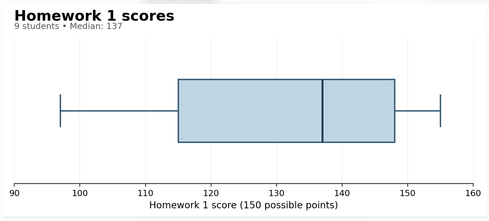
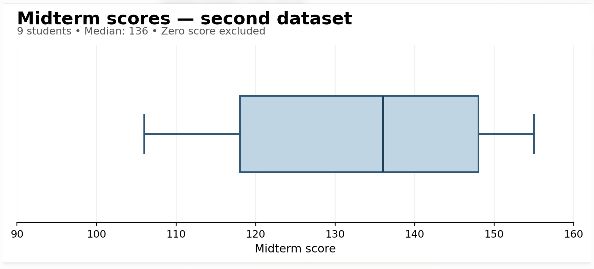
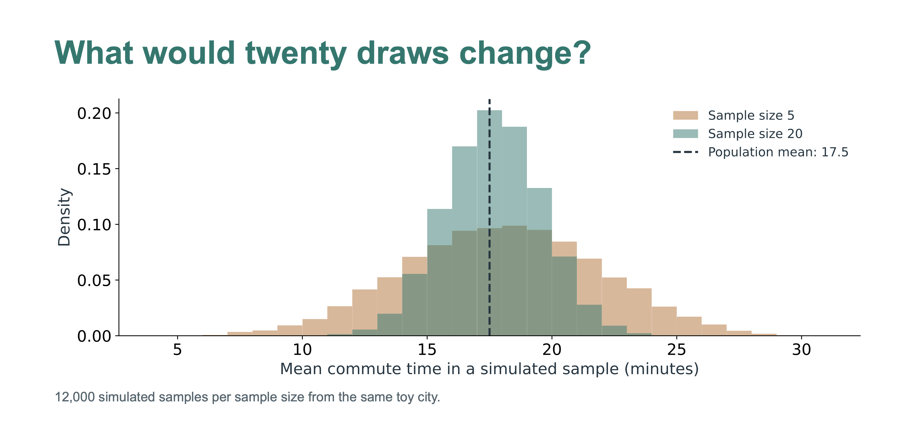
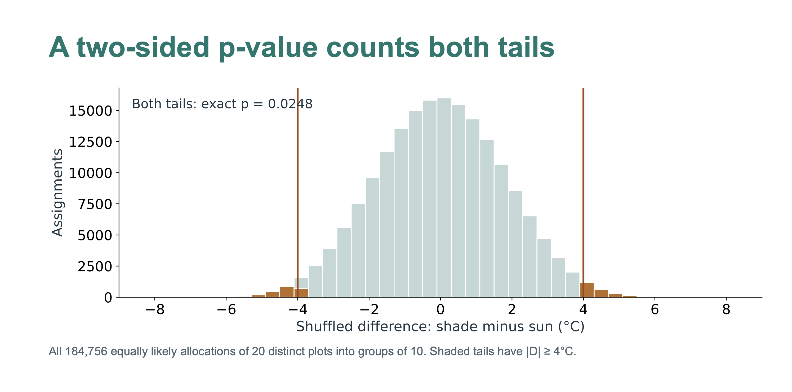
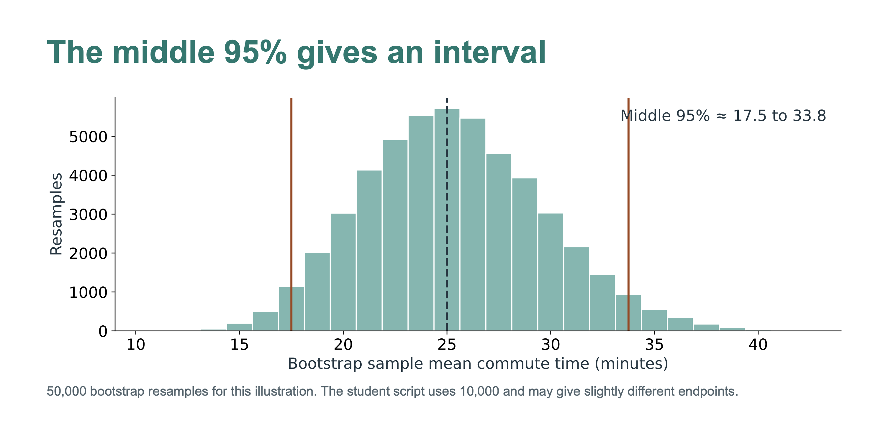
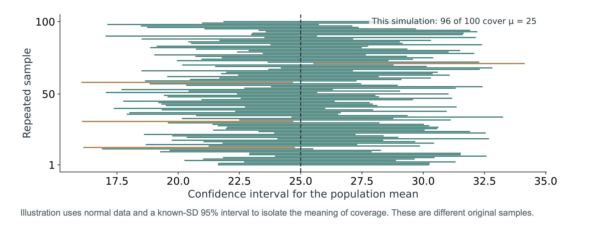

```{=html}
<style>
.reveal {font-family: Arial, sans-serif; font-size: 32px; color:#233742;}
.reveal h1,.reveal h2 {color:#06796f; font-weight:700; text-transform:none;}
.reveal h2 {font-size:1.5em; margin-bottom:0.55em;}
.reveal p,.reveal li {line-height:1.35;}
.reveal table {font-size:.79em; width:100%;}
.reveal th {color:#06796f;}
.reveal pre {font-size:.63em; box-shadow:none; width:100%;}
.reveal pre code {max-height:520px; padding:20px;}
.plot svg {width:100%; max-height:470px;}
.caption {font-size:.57em; color:#52656e;}
.reveal strong {color:#075f58;}
.reveal blockquote {box-shadow:none; background:#edf6f3; padding:20px; width:90%; font-style:normal;}
</style>
```

## HW1 + Midterm Scores

{fig-align="center"}

## HW1 + Midterm Scores

{fig-align="center"}

## What can a sample tell us?

### From Description and Exploration to Inference

> What is Statistical Inference?

**Making conclusions about a population using information in a sample!**

- How long do residents in a city spend their time commuting?

  - Making estimates about a population parameter.

- Does providing shade in an area reduce exposure to heat?

  - Hypothesis testing : testing research claims

    - Is what we observe due to what we claim?

    - Or is it due to random chance/ natural variability in sampling?

::: notes
70-minute route. Slides 1–9: 15 min. Slides 10–20: 25 min. Slides 21–29: 23 min. Slides 30–32: 7 min. For 50 minutes, use one R simulation per student per activity, then demonstrate the bulk-simulation code, and assign the final challenges for home. The student worksheet and R script contain all code. Nothing needs printing. Have students change seat_number in the setup, then pause after each single-simulation block to add a dot to the whiteboard. All datasets are fictional teaching examples. The setup defines student_seed as 1000 + the assigned seat number. Different students therefore contribute different results, with occasional coincident statistics expected. The HTML companion opens offline. In Quarto revealjs, S opens speaker view. The offline HTML uses N to show notes.
:::

## A city has a question

> How long do residents spend commuting?

We can measure everyone, or learn from a sample.

**Inference uses data and a probability model to learn about an unknown quantity and quantify uncertainty.**

::: notes
2 min. Invite examples: household water access, average summer temperature, flood preparedness. Distinguish describing observed cases from making a statement about unobserved residents or a process. Inference also supports experimental comparisons, not only surveys.
:::

## A result needs a reference

**Survey:** our sample mean commute is 25 minutes. How precisely does it estimate the population mean?

**Experiment:** shaded plots average 4°C cooler. Could random assignment produce a difference this large if shade had no effect?

::: notes
2 min. The first is estimation, the second is hypothesis testing. Ask for instinctive answers before introducing vocabulary. Do not label an estimate precise just because there are many resamples.
:::

## Two different sources of variability

| Random sampling | Random assignment |
|------------------------------------|------------------------------------|
| Which people enter the survey? | Which plots receive shade? |
| A different sample can give a different mean. | A different allocation can give a different group difference. |

Each analysis must mimic the source of randomness in its study.

::: notes
2 min. Whiteboard: draw a population and a sample on the left; a fixed set of 20 plots split into treatment groups on the right. Random sampling supports generalization to the sampling population. Random assignment supports a causal comparison for experimental units under the design. Neither automatically gives both.
:::

## Activity 1 · The commute lottery

**A toy city has six equally common commute times:**

5, 10, 15, 20, 25, 30 minutes

Its population mean is **17.5 minutes**.

Prediction: will everyone obtain a sample mean of 17.5?

::: notes
1 min. Each student runs the one-sample R block in the lab. The model is an independent draw from a large population with these six equally likely values. Replacement is appropriate for this toy model. These are not the eight survey observations used later.
:::

## Five draws make one sample

```{r}
#| eval: false
set.seed(student_seed)
my_sample <- city |>
  rep_sample_n(size = 5, reps = 1, replace = TRUE)
my_sample
my_sample |>
  summarise(sample_mean = mean(minutes), .groups = "drop")
```

Inspect five observations. Add **one mean** to the whiteboard.

::: notes
4 min. The lab begins by loading tidyverse and infer, defining city, and setting student_seed to 1000 + the assigned seat number. Assign distinct numbers 1 through class size. Everyone runs only the one-sample block before the bulk simulation. Whiteboard: axis from 5 to 30 minutes. Ask why some values can occur twice and why different students get different means. No printing or paper cards are needed.
:::

## The population stays the same

**The people drawn change. Their mean changes.**

That movement from sample to sample is **sampling variability**.

The distribution of means from repeated samples is a **sampling distribution**.

Its standard deviation is the **standard error**.

::: notes
2 min. Whiteboard: add a vertical marker at 17.5. Sample size five does not guarantee symmetry or closeness in any one sample. The across-sample distribution should center near 17.5. Contrast variability of individual commute times with variability of sample means.
:::

## What would 20 draws change?

{fig-align="center"}

::: notes
1 min. Ask students to predict before revealing the chart if possible. Larger samples tend to give less variable means. Under independent sampling, SE of a mean is σ/√n. Increasing sample size from 5 to 20 approximately halves SE. This reduces random variability, not sampling bias.
:::

## The same lottery in R

```{r}
#| eval: false
library(tidyverse)
library(infer)
city <- tibble(minutes = seq(5, 30, by = 5))
set.seed(student_seed + 1)
sampling_5 <- city |>
  rep_sample_n(size = 5, reps = 2000, replace = TRUE) |>
  summarise(stat = mean(minutes), .groups = "drop")
```

Change `size = 5` to `size = 20` and compare the spread.

::: notes
1 min. rep_sample_n is an infer function, not a moderndive function. Its output is grouped by replicate, allowing summarise to calculate one mean per sample. The full script plots both sample sizes. Do not spend lecture time installing packages. All slide R chunks are displayed, not executed, and the supplied HTML presentation opens without R.
:::

## Activity 2 · Does shade cool a surface?

A fictional experiment uses **20 separated, comparable plots**.

Random assignment gives 10 plots shade cloth and 10 plots sun. Measure surface temperature after one hour.

**Question:** does shade change surface temperature?

::: notes
2 min. Independence, standardized measurement, no spillover, and complete random assignment are assumptions of this teaching experiment. The plots are not paired. Say these are constructed results, not measurements from a real study. Avoid any suggestion that naturally shaded sites were merely compared observationally.
:::

## The observed difference

| Shade: 10 plots    | Sun: 10 plots      |
|--------------------|--------------------|
| 28, 30, 31, 32, 33 | 32, 34, 35, 36, 37 |
| 34, 35, 36, 38, 39 | 38, 39, 40, 42, 43 |
| **Mean = 33.6°C**  | **Mean = 37.6°C**  |

**D = mean(shade) − mean(sun) = −4.0°C**

::: notes
2 min. Whiteboard: write D = shade minus sun, circle the minus sign, and keep this definition visible. A negative difference means cooler in shade. Let students calculate or check the means. Identical temperatures in separate rows represent different plots and remain separate observations.
:::

## A null model gives us a comparison

**Null hypothesis:** shade has no effect on any plot.

Under this sharp null, each plot keeps its observed temperature regardless of its assignment.

**Alternative:** shade changes temperature for at least some plots.

We will use differences in group means to detect a change.

::: notes
2 min. This is an exact randomization test under the sharp null of no individual treatment effect. A simple permutation test does not in general test only equality of means under arbitrary different distributions. At an introductory level emphasize no effect and exchangeable assignments. A mean-difference test can have low power for changes that cancel in the mean. We choose a two-sided statistic and alpha .05 before examining the simulation.
:::

## Everyone becomes a randomization machine

```{r}
#| eval: false
set.seed(student_seed + 10)
one_shuffle <- temperature |>
  specify(temp_c ~ treatment) |>
  hypothesize(null = "independence") |>
  generate(reps = 1, type = "permute")
one_shuffle
```

Inspect the shuffled data before calculating a difference.

::: notes
3 min. Each student uses a different assigned seat number in the lab setup. The temperature data are defined earlier in the lab. In infer, the observed temperature outcomes are shuffled among fixed treatment labels. This is equivalent to reassigning group labels here. Every value appears exactly once, including separate occurrences of tied values. Everyone inspects one generated dataset before calculating a statistic. The lab shows original and shuffled values side by side and group sizes and means.
:::

## What does one dot mean here?

```{r}
#| eval: false
one_shuffle |>
  calculate(stat = "diff in means",
            order = c("shade", "sun"))
```

Add **one difference** to the board.

One dot represents one possible assignment under the null.

::: notes
3 min. Whiteboard: new D axis from −10 to +10°C, with shade minus sun written above it. Each student adds their own statistic. Ask where the dotplot should center, then draw zero and observed ±4. The lab also supplies three-shuffle code, so every student can add three further dots if time permits. Discuss the class plot before anyone runs 10,000 permutations. Use the same seed for reproducibility, not to obtain fresh results by repeatedly resetting it.
:::

## A two-sided p-value counts both tails

{fig-align="center"}

::: notes
2 min. Exact benchmark p = 0.024822. Include ties at −4 and +4. This exact enumeration uses distinct plots, even when temperatures match. Do not count unique value splits as equally likely. Classroom dots are a rough Monte Carlo approximation and may give zero tail points. That is not proof that the actual p-value is zero.
:::

## What does the p-value say?

**Assuming the null model and study assumptions hold**, the p-value is the probability of obtaining a test statistic at least as extreme as the observed statistic.

For this test, “as extreme” means **D ≤ −4 or D ≥ +4**.

A smaller p-value indicates greater incompatibility with the null model.

::: notes
2 min. Ask students to complete “If shade has no effect ...”. Explicitly correct “the probability the null is true”, “the probability this happened by chance”, and “the probability the result will replicate”. The probability concerns a statistic under a specified model, not the truth of a hypothesis. Randomization probability here comes from possible treatment allocations.
:::

## The shuffle in infer

```{r}
#| eval: false
set.seed(student_seed + 12)
null_dist <- temperature |>
  specify(temp_c ~ treatment) |>
  hypothesize(null = "independence") |>
  generate(reps = 10000, type = "permute") |>
  calculate(stat = "diff in means",
            order = c("shade", "sun"))
```

The student script defines `temperature` and calculates `observed`.

::: notes
1 min. infer permutes the response among the fixed treatment labels, which is equivalent here to shuffling treatment assignments. hypothesize labels independence in the API; its design justification in this example is the sharp no-effect null. Explain each verb in one sentence. order fixes the sign.
:::

## The computer counts the tails

```{r}
#| eval: false
null_dist |>
  get_p_value(obs_stat = observed, direction = "both")

visualize(null_dist) +
  shade_p_value(obs_stat = observed, direction = "both")
```

10,000 shuffles improve simulation precision.

They do **not** increase the experiment’s sample size.

::: notes
1 min. infer uses its two-sided convention, based on doubling a tail probability. The exact null distribution in this balanced experiment is symmetric, so this agrees with counting \|D\| ≥ 4 in the exhaustive distribution. Finite Monte Carlo estimates can differ slightly. The full student script reports both approaches. No exact R simulation output is hard-coded in the slides.
:::

## Evidence, magnitude, and decisions

**Observed difference:** shade plots average 4°C cooler.

**Evidence:** the randomization test assesses compatibility with no effect.

**Decision rule:** with α = 0.05 set in advance, reject when p ≤ 0.05.

Would 0.049 and 0.051 justify very different scientific stories?

::: notes
2 min. This dataset yields an exact p below .05. Reject the no-effect null under the experimental assumptions. Do not say prove shade works everywhere. Do not interpret statistical significance as effect importance. Alpha is a long-run Type I error control under the null, not a posterior probability of error for this result. Spatially separated plots do not automatically guarantee no spatial dependence; they are assumed independent here.
:::

## Activity 3 · How long is the commute?

A **separate fictional survey** takes a simple random sample of eight residents from a large city population.

10, 15, 15, 20, 25, 30, 35, 50 minutes

**Sample mean = 25 minutes.**

How much uncertainty surrounds that estimate?

::: notes
2 min. This is a survey, not an experiment and not the known lottery population. We treat the population as large and observations as independent. The two 15s represent two people. Eight observations make inspecting one resample manageable but form a deliberately small, somewhat skewed sample. Treat its percentile interval as a teaching approximation. A larger survey is preferable for substantive inference.
:::

## The population is out of reach

We would like many new samples from the city.

We have only **one sample**.

The bootstrap uses that sample as an approximation to the population and resamples it to estimate sampling variability.

::: notes
1 min. Whiteboard: unknown population as a cloud, one eight-person sample, multiple resamples. The bootstrap distribution is conditional on the observed sample; it approximates rather than equals the true sampling distribution. Resampling cannot recover omitted subpopulations or unseen extremes.
:::

## Everyone makes a bootstrap sample

```{r}
#| eval: false
set.seed(student_seed + 20)
one_bootstrap <- commute |>
  specify(response = minutes) |>
  generate(reps = 1, type = "bootstrap")
one_bootstrap
one_bootstrap |> calculate(stat = "mean")
```

Inspect eight draws. Add **one mean** to a new board axis.

::: notes
5 min. The lab defines the separate eight-person survey. Ask students to compare original values with the eight generated values. Some respondent observations repeat and others may be absent, although a particular resample can by chance use every respondent once. The two original 15s already represent different people, so repeated values alone do not identify which respondent was redrawn. One resample still has eight observations. Add each mean to a separate minutes axis marked at 25. Discuss the empirical distribution before 10,000 resamples. The lab also supplies three-bootstrap code.
:::

## Why does replacement matter?

Without replacement, selecting all eight respondents returns the same eight observations every time.

**Every mean would equal 25.**

`type = "bootstrap"` samples with replacement, allowing the composition and mean to vary while keeping n = 8.

::: notes
1 min. Ask students what would happen if R simply reordered the eight survey rows and then took their mean. Shuffling row order alone does not generate uncertainty in a single mean. Replacement creates new empirical samples, not new real observations.
:::

## Bootstrapping in infer

```{r}
#| eval: false
set.seed(student_seed + 22)
boot_dist <- commute |>
  specify(response = minutes) |>
  generate(reps = 10000, type = "bootstrap") |>
  calculate(stat = "mean")

ci_95 <- boot_dist |>
  get_confidence_interval(level = 0.95, type = "percentile")
```

No null hypothesis is imposed in this estimation workflow.

::: notes
1 min. commute is defined in the student script as an eight-row tibble. Each generate replicate draws eight rows with replacement. Explain that the statistic is a mean and every replicate has the original n. The same basic pattern estimates other parameters if appropriate to the data and statistic.
:::

## The middle 95% gives an interval

{fig-align="center"}

::: notes
2 min. Illustration interval: 17.500 to 33.750 minutes. Draw vertical lines leaving 2.5% in each tail. The central 95% of bootstrap statistics yields a percentile interval for the population mean. This is not an interval containing 95% of individual commute times. With n=8 and skew, nominal 95% coverage need not be accurate.
:::

## What does “95% confidence” mean?

**It describes the interval-making procedure.**

Across repeated random samples, a well-calibrated 95% procedure produces intervals that contain the fixed population mean about 95% of the time.

Our computed interval either contains that mean or misses it. We do not know which.

::: notes
2 min. The parameter is fixed in the frequentist interpretation; intervals vary. “We are 95% confident that the population mean is between L and U” is conventional language, justified by procedure coverage. Do not assign a 95% frequentist probability to the fixed parameter falling in this realized interval. Bootstrap coverage is approximate, especially for tiny or skewed samples.
:::

## Repeated intervals, one population mean

{fig-align="center"}

::: notes
1 min. These are not 100 resamples from one sample. Each interval starts with a new independent sample from the same population. The visualization intentionally uses an exact normal-mean interval, not the small commute-sample percentile bootstrap. Coverage is a long-run property, not a promise of exactly 95 successes out of 100.
:::

## What a confidence interval does not say

“95% of residents commute for a time inside this interval.”

“95% of future sample means must fall inside this interval.”

“There is a 95% frequentist probability that the fixed mean lies in this computed interval.”

**Each statement misinterprets the interval.**

::: notes
2 min. Have pairs rewrite one statement. Correct target: uncertainty about the population mean, assessed through repeated-sampling performance of the interval procedure. A narrow interval can be confidently wrong if the sampling frame excludes many residents. Do not use a bootstrap of a convenience sample to imply population representativeness.
:::

## Two simulations, two questions

|   | Shuffling | Bootstrapping |
|------------------------|------------------------|------------------------|
| Question | Is the statistic unusual under a null model? | How variable is our estimate? |
| Action today | Reassign outcomes to groups | Draw rows with replacement |
| What stays fixed? | Values and group sizes | Original sample and resample size |
| Typical center | Null value: 0 here | Observed estimate: 25 here |
| Output today | p-value | Confidence interval |

::: notes
2 min. Ask students to explain why a null distribution cannot simply serve as a confidence interval distribution. These are introductory workflows, not universal statements that bootstrap can never be used for testing or randomization can never be inverted for intervals. The two centers have different units here because we used different case studies.
:::

## A geographic conclusion needs a design

**Random sampling** supports inference to the sampling population.

**Random assignment** supports a causal comparison for experimental units.

Nearby sites, repeated observations, and clustered households may require different resampling units.

More resamples cannot repair a biased sample.

::: notes
2 min. Whiteboard: three nearby houses inside one neighborhood. If neighborhood is the independent unit, resampling individual houses can understate uncertainty. Mention cluster or spatial block resampling as later methods, without teaching them today. Restrict shuffles to what the assignment design actually permitted, for example within blocks. Do not use the simple code unchanged for dependent spatial data.
:::

## Three-minute exit ticket

1.  What does one dot represent in each of our three distributions?
2.  Why does shuffling preserve each outcome once while bootstrapping allows repeated observations?
3.  A p-value is 0.03. Write one valid interpretation.
4.  What changes when we increase resamples from 1,000 to 10,000? What changes when we increase sample size?

::: notes
3 min. Answers: sampling means from new five-person samples; randomization differences under no effect; bootstrap means from resamples of the observed eight-person sample. No replacement preserves fixed experimental outcomes and group sizes; bootstrap replacement allows new empirical samples of original size. Valid p interpretation is conditional on null and assumptions, for as-extreme-or-more statistics. Reps reduce Monte Carlo error; sample size can reduce statistical uncertainty. Have students exchange answers or submit before leaving.
:::

## After class

**Read:** IMS Chapters 11, 12, 13, 14, 15.

**Practice:** Lesson on foundation of inference

**Use the worksheet:** change sample size, resample count, and confidence level. Predict each result before running it.
